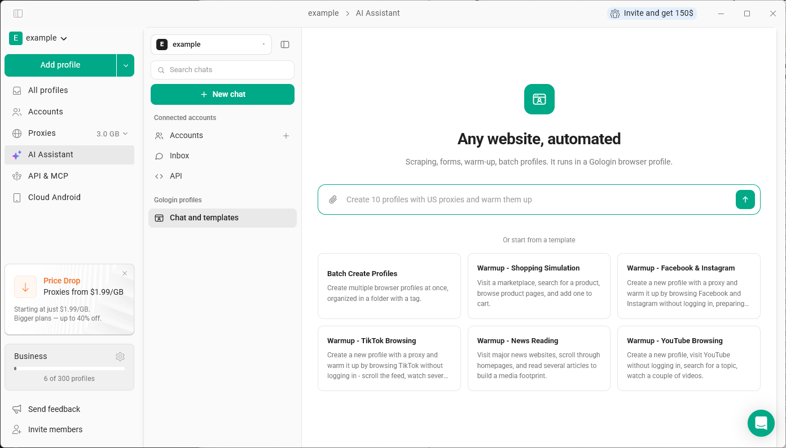

**AI Assistant** ist ein Chat-Assistent, der in die Gologin-App integriert ist. Er kann deine Browserprofile verwalten und auf Websites in einem Gologin-Profil so arbeiten, wie es ein normaler Nutzer tun würde – klicken, tippen, Formulare ausfüllen und scrollen.

Um ihn zu öffnen, klicke im linken Menü auf **AI Assistant**.

## Was du ihn erledigen lassen kannst

**Profile verwalten:**

- deine Profile auflisten und Profildetails anzeigen
- Profile erstellen, aktualisieren, klonen oder löschen
- Profile in Ordnern organisieren und Tags hinzufügen
- Proxys einrichten und Profilen zuweisen
- die Cookies eines Profils abrufen

**Auf Websites in einem Profil arbeiten:**

- ein Profil starten oder beenden
- Websites öffnen und Links folgen
- den sichtbaren Seiteninhalt lesen
- auf Schaltflächen, Links und Menüs klicken, in Felder tippen, Formulare absenden, scrollen und Optionen auswählen

Beispielanfragen:

- „Erstelle 10 Profile mit US-Proxys und wärme sie auf“
- „Verschiebe diese Profile in einen Ordner namens Clients“
- „Öffne diese Website im Profil Research und sammle die Preise von der ersten Seite“

## Templates

Unter **Chat and templates** kannst du mit einem fertigen Szenario starten: **Batch Create Profiles** sowie Warm-up-Szenarien für **Facebook & Instagram**, **TikTok**, **YouTube**, **Shopping Simulation** und **News Reading**. Ein Warm-up-Template erstellt ein neues Profil mit einem Proxy und surft auf der Website, ohne sich anzumelden. So baut das Profil einen natürlichen Browserverlauf auf, bevor du es verwendest.

## Gute Anfragen formulieren

Der Assistent handelt nur nach deinen Vorgaben. Gib ihm eine klare, konkrete Aufgabe: Welches Profil soll verwendet werden, welche Website soll geöffnet werden und was soll dort geschehen? Er entscheidet nicht von selbst, was er postet, liked oder kommentiert.

## Einschränkungen

- Der Assistent kann keine CAPTCHAs, reCAPTCHAs oder andere Prüfungen zur Erkennung menschlicher Nutzer lösen und keine Anmelde-, E-Mail- oder Zwei-Faktor-Verifizierung durchlaufen. Wenn eine solche Prüfung erscheint, schließe sie selbst im Profil ab und lass den Assistenten danach fortfahren.
- Aktionen mit weitreichenden Folgen – Käufe, Zahlungen, das Senden von Nachrichten, das Löschen von Daten, das Ändern von Sicherheitseinstellungen oder das Akzeptieren von Vereinbarungen – führt er nur mit deiner ausdrücklichen Bestätigung aus.

## Siehe auch

- [Connected Accounts](/de/ai/connected-accounts)
