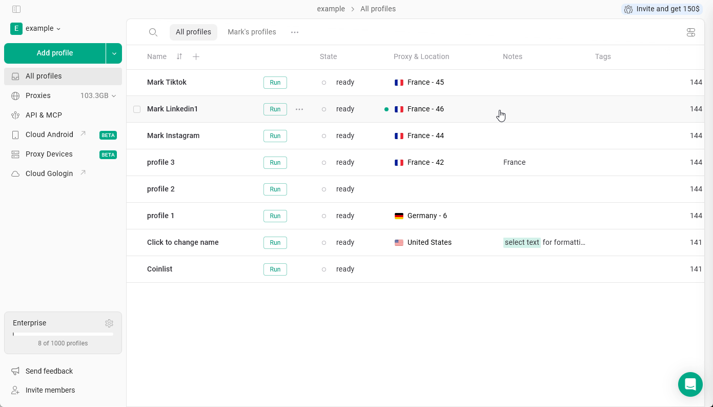
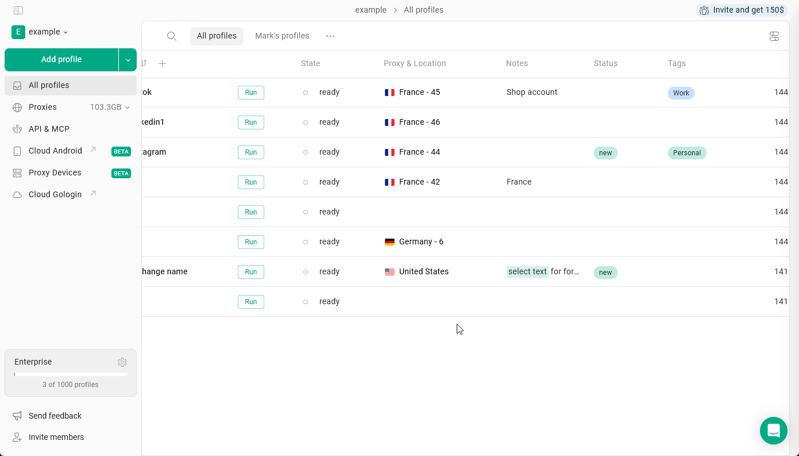
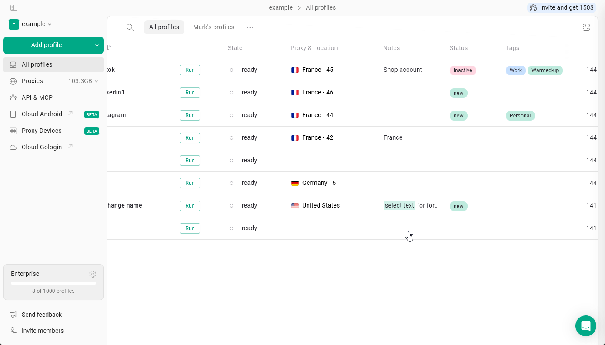
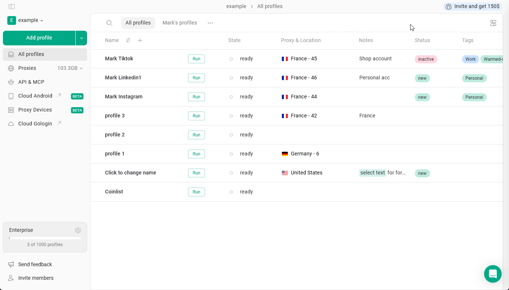

Mit diesen Textfeldern in den Profilen lassen sich Profile leicht unterscheiden, filtern und finden.

## Notes

Mit **Notes** in Gologin können Sie zusätzliche Informationen direkt in jedem Browserprofil speichern. Das ist nützlich, um Kontodaten, Erinnerungen oder anderen Kontext zu einem bestimmten Profil festzuhalten.

Um **einem Profil eine Notiz hinzuzufügen**, klicken Sie einfach auf das Notizfeld des Profils und beginnen Sie zu tippen.

<Frame>
  
</Frame>

Notizen unterstützen grundlegende **Formatierungen**, darunter **fett**, _kursiv_, ~~durchgestrichen~~, Hintergrundfarbe und <u>unterstrichen</u>.  Markieren Sie einfach den Text und wenden Sie die gewünschte Formatierung an!

## Tags and Status

Mit **Tags** können Sie Profile mit Schlagwörtern versehen, um sie nach Kontotyp, Plattform oder Projekt zu kategorisieren und zu filtern. **Status** zeigt dagegen den Stand im Arbeitsablauf an.

<Info>
  Diese Felder sind standardmäßig ausgeblendet. Auf [dieser Seite](/de/browser-profiles/profile-management/add-more-info-columns) erfahren Sie, wie Sie sie in den Einstellungen aktivieren.
</Info>

<Tip>
  Der wichtigste Unterschied: Ein Profil kann mehrere Tags haben, aber nur einen Status.
</Tip>

### Create or add

Um **einen neuen Tag oder Status zu erstellen**, klicken Sie im Profil auf das entsprechende Feld und beginnen Sie zu tippen. Beim Erstellen oder Bearbeiten können Sie auch **eine Farbe** wählen: Verwenden Sie eine der voreingestellten Farben oder legen Sie **Ihre eigene** mit dem Farbwähler oder einem HEX-Code fest.

Sie können einem Profil **vorhandene Tags zuweisen**, indem Sie sie aus der Liste auswählen.

<Frame>
  
</Frame>

### Filter by

Sie können Profile nach Status oder Tags filtern. Klicken Sie dazu auf das entsprechende Feld und wählen Sie den Tag oder Status aus, nach dem Sie filtern möchten.

Um den Filter zurückzusetzen, klicken Sie auf den Pfeil neben der Feldkategorie.

<Frame>
  
</Frame>

### Modify tags and status

- Um einen Tag oder Status von einem Profil zu **entfernen**: Klicken Sie auf das Feld → klicken Sie auf **X** neben dem Eintrag
- Um einen Tag oder Status **vollständig zu löschen**: Klicken Sie auf das Feld → klicken Sie in der Liste auf die **drei Punkte** neben dem Eintrag → **Delete**

Aus dieser Liste können Sie auch die Farben von Tags und Status ändern.

<Frame>
  
</Frame>

## Teamwork

Diese Felder verhalten sich bei geteilten Profilen, Ordnern und Workspaces unterschiedlich.

- **Notizen werden vollständig synchronisiert**. Änderungen an Notizen sind für alle Teammitglieder sichtbar.
- **Tags und Status sind benutzerspezifisch**. Wenn Sie ein Profil teilen, sehen die Empfänger Ihre Tags und Ihren Status nicht und können eigene vergeben, passend zu ihrem Arbeitsablauf.

<Info>
  Teammitglieder benötigen die Berechtigung „can edit“, um Notizen, Status und Tags eines Profils zu ändern.
</Info>
