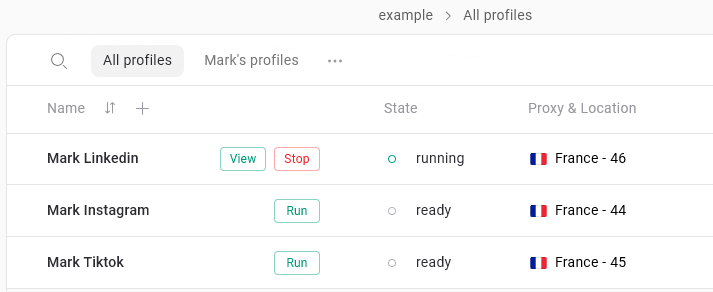

Die **Profilsynchronisierung** in Gologin sorgt dafür, dass Ihre Browserprofile – einschließlich aller Fingerprints, Cookies, Local Storage und Erweiterungen – automatisch in der Cloud gespeichert werden. Das bedeutet:

- Sie können **über das Web oder auf jedem Gerät, auf dem Gologin installiert ist, auf dasselbe Profil zugreifen**
- Ihre Teammitglieder können **gemeinsam an geteilten Profilen arbeiten**
- Ihre Profile bleiben **konsistent**, unabhängig davon, von wo aus sie gestartet werden

## So funktioniert die Synchronisierung

Wenn ein Profil ordnungsgemäß geschlossen wird, lädt Gologin die aktuellen Profildaten auf die Cloud-Server hoch. Beim nächsten Start des Profils wird der gespeicherte Zustand wiederhergestellt. So bleiben Ihre Sitzungsdaten, Cookies und der Browserzustand konsistent.

Profile werden in der Gologin-Cloud gespeichert und mit Ihrem Konto verknüpft. Sie bleiben also verfügbar, wenn Sie die App neu installieren oder sich auf einem anderen Computer anmelden. Sitzungsdaten, die vor dem Schließen nicht synchronisiert wurden, können verloren gehen.

## So verwenden Sie Ihre Profile sicher

- **Stellen Sie sicher, dass die Synchronisierung abgeschlossen ist, bevor Sie den Computer herunterfahren.**\
  Der Status sollte **ready** anzeigen und die Schaltfläche **Run** beim Profil sollte aktiv sein. Dann sind die Profildaten synchronisiert.
- **Schließen Sie die Profile, bevor Sie den Computer herunterfahren oder die App beenden.**\
  Schließen Sie Profile, indem Sie das **Profilfenster schließen** oder in der App auf **Stop** klicken, damit die Synchronisierung abgeschlossen wird.
- **Verwenden Sie ein Profil nicht gleichzeitig auf mehreren Geräten.**\
  Das ist zwar möglich, wird aber nicht empfohlen: Nur eines der gleichzeitig gestarteten Profile kann mit den Cloud-Servern synchronisiert werden. Dadurch können Abweichungen zwischen dem gespeicherten Profilstand und den Erwartungen der Website entstehen, was Ihren Trust Score senken kann.
- **Schließen Sie das Profil nicht, wenn Sie keine Internetverbindung haben.**\
  Ist die Synchronisierung nicht abgeschlossen, können Sie den aktuellen Fortschritt verlieren und müssen Daten aus früheren Sitzungen wiederherstellen.

<Frame>
  
</Frame>

## Sicherheitsregeln für die Synchronisierung

Damit Ihre Profildaten intakt bleiben, beachten Sie diese Regeln:

- Stellen Sie sicher, dass die Synchronisierung abgeschlossen ist, bevor Sie die Anwendung beenden
- Warten Sie, bis der Profilstatus Ready anzeigt
- Schließen Sie Profile immer, bevor Sie Ihren Computer herunterfahren
- Führen Sie dasselbe Profil nicht gleichzeitig auf mehreren Geräten aus
- Vermeiden Sie es, Profile bei instabiler Internetverbindung zu schließen

Wenn dasselbe Profil gleichzeitig auf verschiedenen Geräten ausgeführt wird, kann es zu Inkonsistenzen bei den gespeicherten Sitzungsdaten kommen.
