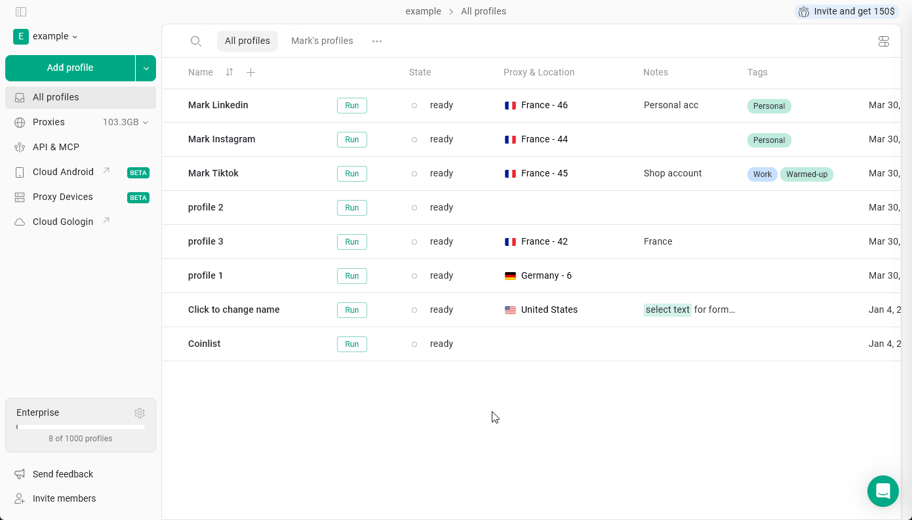

Jedes Mal, wenn du ein Gologin-Profil startest und schließt, erstellt das System automatisch einen **Sitzungs-Snapshot**. Mit dem **Profile history** in Gologin kannst du eine der **bis zu 5 letzten Sitzungen** wiederherstellen.

Ein Sitzungs-Snapshot enthält:

- Cookies
- Session Storage
- Anmeldestatus
- Website-Tokens
- Browserdaten aus dieser Sitzung

Bei Bedarf kannst du das Profil auf jeden dieser früheren Sitzungsstände zurücksetzen. Wurde das Profil nicht ordnungsgemäß geschlossen, wird diese Sitzung nicht gespeichert und kann nicht wiederhergestellt werden.

## Wie stelle ich die Sitzung eines Profils wieder her?

Um dein Profil auf eine der 5 letzten Sitzungen zurückzusetzen, gehe einfach so vor:

1. Klicke beim Profil auf die **3 dots**
2. Wähle **History**
3. Wähle die gewünschte Sitzung aus
4. Klicke auf **Restore**

<Frame>
  
</Frame>

## Wann sollte ich den Profilverlauf nutzen?

Die Wiederherstellung aus Snapshots kann in diesen Fällen hilfreich sein:

1. **Ein Account wurde abgemeldet**\
   Wenn eine Website dich unerwartet abmeldet, kannst du eine frühere Sitzung wiederherstellen, in der der Account noch angemeldet war.
2. **Verlorene Daten**\
   Wenn du die zuletzt geöffneten Tabs nicht siehst oder vermutest, dass die letzte Profilsynchronisierung wegen Netzwerkproblemen nicht korrekt war.
3. **Fehlerhafter Website-Zustand**\
   Wenn sich eine Website aufgrund von Cache-Änderungen oder dem Eingriff einer Erweiterung nicht wie vorgesehen verhält.
4. **Profil nicht funktionsfähig**\
   Wenn du ein Profil aus Gründen, die nichts mit dem Proxy zu tun haben, nicht starten kannst, zum Beispiel weil die vorherige Sitzung nicht korrekt synchronisiert wurde.

## Bewährte Vorgehensweisen

- **Schließe Profile immer ordnungsgemäß**\
  Ein abruptes Beenden kann zu instabilen Snapshots führen.
- **Nutze die Wiederherstellung nicht übermäßig**\
  Ständiges Wechseln zwischen Sitzungen kann unnatürlich wirken.
- **Halte den Proxy konsistent**\
  Wenn du eine US-Sitzung wiederherstellst, während du einen neuen EU-Proxy verwendest, können Cookies ungültig werden.
- **Verwende die Funktion als Wiederherstellungswerkzeug**\
  Sie eignet sich am besten, um Fehler zu beheben oder Instabilität rückgängig zu machen.
