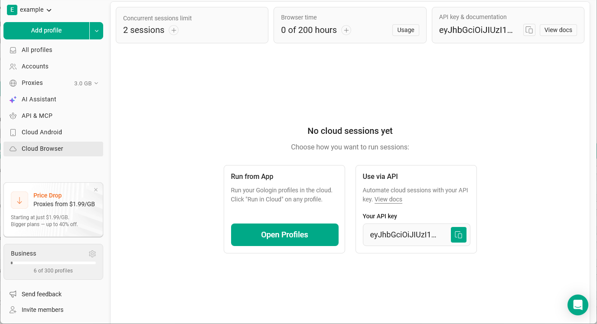
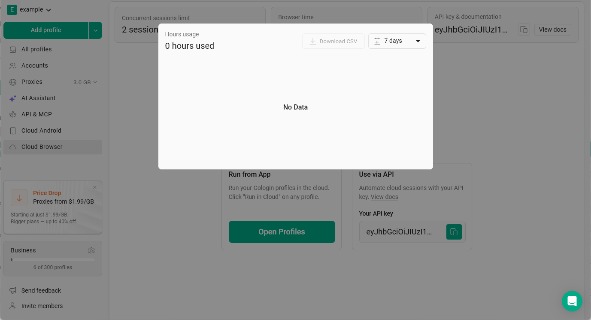
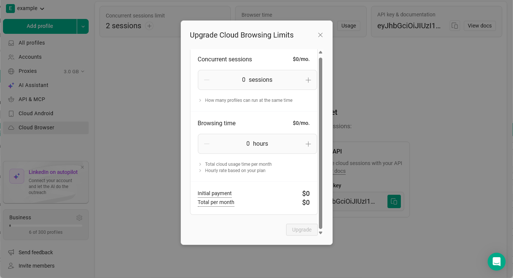

Das **Cloud Browser** Dashboard zeigt Ihre Cloud-Browser-Limits und die Nutzung – für Profile, die mit **Run in Cloud**, in der Web-App oder über die Cloud Browser API gestartet werden – und ermöglicht es Ihnen, zusätzliche Cloud-Limits zu kaufen.

So öffnen Sie die Seite: Klicken Sie im linken Menü auf **Cloud Browser**.

## Was Sie dort finden

Oben auf der Seite:

- **Concurrent sessions limit** – wie viele Cloud-Profile gleichzeitig laufen können. Klicken Sie auf **\+**, um weitere Sitzungen zu kaufen.
- **Browser time** – die in diesem Monat verbrauchten Cloud-Stunden von Ihrem Monatslimit, zum Beispiel **0 of 200 hours**. Klicken Sie auf **\+**, um weitere Stunden zu kaufen, oder auf **Usage**, um die Statistik anzuzeigen.
- **API key & documentation** – der Token für die Cloud Browser API. Klicken Sie auf das Kopiersymbol, um ihn zu kopieren, oder auf **View docs**, um die API-Dokumentation zu öffnen.

Wenn Sie noch keine Cloud-Profile gestartet haben, zeigt die Seite zwei Möglichkeiten für den Einstieg:

- **Run from App** – klicken Sie auf **Open Profiles** und dann bei einem beliebigen Profil auf **Run in Cloud**.
- **Use via API** – kopieren Sie **Your API key** und klicken Sie auf **View docs**, um zu sehen, wie Sie ihn verwenden.

### Nutzungsstatistik

Klicken Sie im Block **Browser time** auf **Usage**, um zu sehen, wie viele Cloud-Stunden Sie verbraucht haben. Wählen Sie oben rechts den Zeitraum, zum Beispiel **7 days**, und klicken Sie auf **Download CSV**, um die Daten herunterzuladen.

## Zusätzliche Cloud-Limits kaufen

Klicken Sie auf **\+** neben **Concurrent sessions limit** oder **Browser time**. Wählen Sie im Fenster **Upgrade Cloud Browsing Limits** aus, was Sie benötigen:

- **Concurrent sessions** – **\$2 pro Sitzung und Monat**. Legt fest, wie viele Profile gleichzeitig in der Cloud laufen können.
- **Browsing time** – zusätzliche Cloud-Stunden pro Monat. Der Stundenpreis hängt von Ihrem Tarif ab: **\$0.09** bei Professional, **\$0.08** bei Business, **\$0.07** bei Enterprise und **\$0.05** bei Custom-Tarifen.

Das Fenster zeigt, wie viel Sie jetzt bezahlen (**Initial payment**) und wie viel pro Monat (**Total per month**). Klicken Sie zum Bezahlen auf **Upgrade**. Zusätzliche Cloud-Limits können nur über **Stripe** bezahlt werden – PayPal und Kryptowährungen sind dafür nicht verfügbar.

### So funktioniert die Abrechnung zusätzlicher Limits

Der Preis für zusätzliche Limits ist bei Monats- und Jahrestarifen gleich, die Abrechnung unterscheidet sich jedoch:

- **Monatstarif** – Sie bezahlen die zusätzlichen Limits nur bis zum Ende Ihres aktuellen Abrechnungszeitraums. Danach werden sie zusammen mit Ihrem Tarif verlängert.
- **Jahrestarif** – Sie bezahlen jeweils einen Monat im Voraus. Zusätzliche Limits werden dann jeden Monat separat abgerechnet, bis Ihr Jahrestarif endet.

<Note>
  Cloud-Browser-Profile und zusätzliche Cloud-Limits sind nur in kostenpflichtigen Tarifen verfügbar.
</Note>
