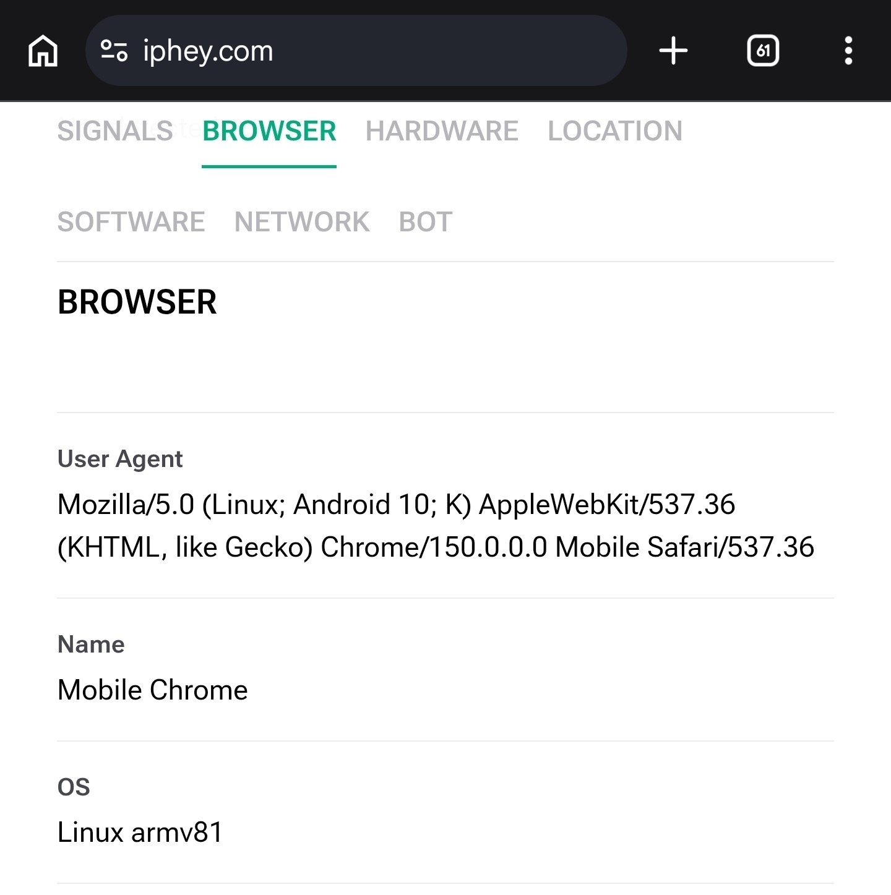
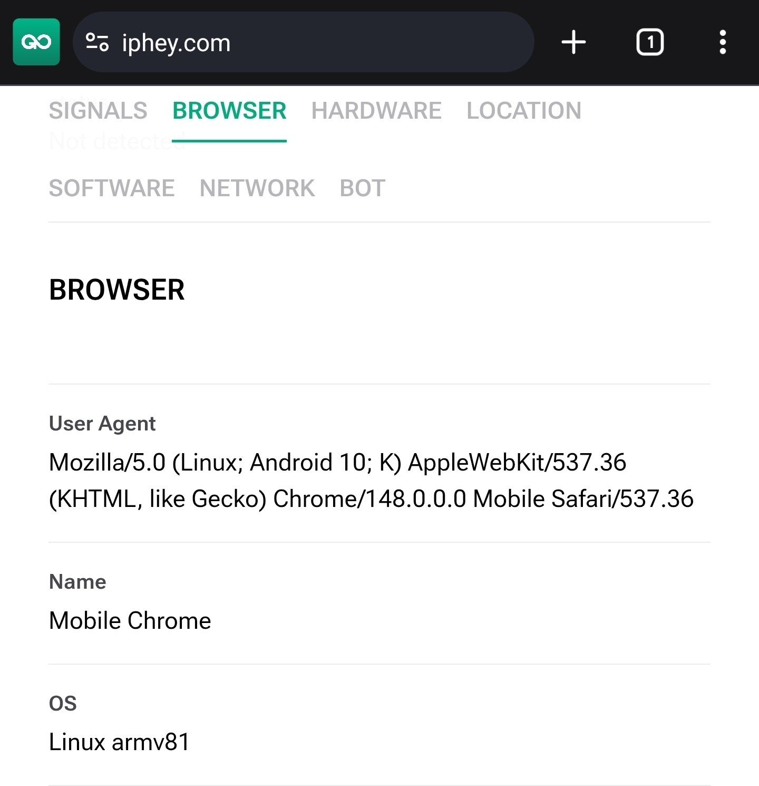

Wenn Sie in Gologin ein Android-Profil erstellen und dessen User-Agent prüfen, werden Sie feststellen, dass dort immer `Android 10; K` steht, selbst wenn das Profil auf Android 14, 15 oder 16 eingestellt ist. Der String sieht etwa so aus:

```text
Mozilla/5.0 (Linux; Android 10; K) AppleWebKit/537.36 (KHTML, like Gecko) Chrome/... Mobile Safari/537.36
```

Das ist erwartetes Verhalten und kein Fehler. **Jeder moderne Chrome-basierte Browser unter Android meldet dasselbe.**

## Warum das so ist

Mit Chrome 110 Anfang 2023 hat Google eine Änderung namens **User-Agent Reduction** eingeführt. Damit Browser schwerer zu verfolgen und per Fingerprinting zu identifizieren sind, gibt Chrome im User-Agent nicht mehr die echte Android-Version und das echte Gerätemodell preis. Stattdessen sendet Chrome nun für alle feste Platzhalterwerte:

- Die Android-Version ist auf `Android 10` festgelegt
- Das Gerätemodell wird durch den Buchstaben `K` ersetzt
- Die Nebenversionsnummern von Chrome werden auf `0.0.0` gesetzt

Nur die Hauptversion von Chrome wird mit jedem Release weiter aktualisiert. Alles andere in diesem Teil des Strings bleibt für alle Geräte gleich.

Der Android-Browser von Gologin basiert auf Chromium und folgt daher demselben Standard. Auch Chrome, Edge, Opera und Samsung Internet zeigen `Android 10; K` an. Das ist nicht Gologin-spezifisch, sondern so funktioniert das moderne mobile Web.

<Info>
  Das `K` ist weder eine Android-Version noch ein Tippfehler. Es ist ein Platzhalter, den Chrome inzwischen anstelle des echten Gerätemodells verwendet.
</Info>

## Warum das für Sie von Vorteil ist

Da nahezu jeder Chrome-Nutzer unter Android weltweit inzwischen `Android 10; K` meldet, geht Ihr Profil in der Masse unter. Würde Gologin stattdessen die echte Android-Version melden, würde Ihr Profil aus dem normalen Datenverkehr herausstechen und für Websites ungewöhnlich wirken. Genau das Standardverhalten ist das, was Sie für ein Browserprofil brauchen, das wie ein gewöhnlicher Besucher aussehen soll.

<Check>
  Ein Android-Profil, das `Android 10; K` anzeigt, verhält sich korrekt und wirkt wie ein typisches, echtes Android-Gerät.
</Check>

Websites, die die echte Android-Version oder das Gerätemodell tatsächlich benötigen, fragen diese Informationen inzwischen über einen neueren, datenschutzfreundlicheren Kanal ab (sogenannte Client Hints), statt sie aus dem User-Agent zu lesen. Auch wenn der User-Agent `Android 10` angibt, geht also nichts verloren, und Ihre Auswahl der Android-Version wird dort angewendet, wo es darauf ankommt.

## Sehen alle meine Android-Profile gleich aus?

Nein. Profile unterscheiden sich durch Bildschirmauflösung, WebGL, Canvas und Hardwareparameter. Nur der User-Agent-String ist identisch, genau wie bei echten Android-Geräten.

## So können Sie es selbst testen

Sie können das auf jedem echten Android-Gerät überprüfen, indem Sie ein Gologin-Profil und Ihren normalen Chrome-Browser direkt miteinander vergleichen.

Öffnen Sie [iphey.com](https://iphey.com) oder einen anderen vertrauenswürdigen Fingerprint-Checker in Ihrem normalen Chrome-Browser und wechseln Sie zum Tab **Browser**. Öffnen Sie dann dieselbe Seite in einem Gologin-Android-Profil. Sehen Sie sich in beiden die Zeile **User Agent** an.

In beiden Browsern sehen Sie exakt denselben Wert `Android 10; K`, obwohl sie auf einem modernen Android-Gerät laufen. Der einzige Unterschied ist die Chrome-Versionsnummer, die lediglich das jeweilige Release des Browsers widerspiegelt.

Da beide Browser dasselbe melden, ist dieser direkte Vergleich der einfachste Weg, um zu sehen, dass Gologin genau das tut, was auch ein normaler Chrome-Browser tut.

<Columns cols={2}>
  <Column>
    <Frame>
      
    </Frame>
  </Column>
  <Column>
    <Frame>
      
    </Frame>
  </Column>
</Columns>
