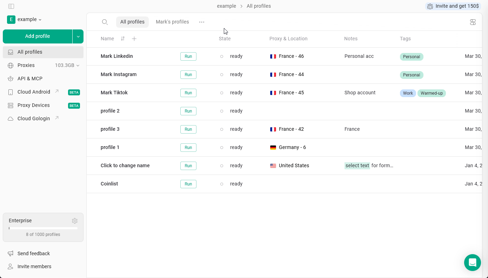

Gologin conserva tus perfiles durante al menos **120 horas** después de eliminarlos, para que puedas recuperar los perfiles eliminados por error desde el menú **Restore profiles**. ¡Esta función está disponible en cualquier plan de pago!

## Cómo restaurar tus perfiles

1. Haz clic en el **workspace name** en la esquina superior izquierda
2. Ve a **Settings & Members**
3. Abre la pestaña **Restore profiles**
4. Busca los perfiles que necesitas recuperar y haz clic en **Restore**

<Frame>
  
</Frame>

Los perfiles restaurados aparecerán en la página **All profiles**.

<Note>
  Los perfiles eliminados hace más de 120 horas no se pueden restaurar. Si no encuentras los perfiles perdidos, intenta buscarlos por su nombre con la función de búsqueda o contacta con soporte para obtener ayuda.
</Note>
