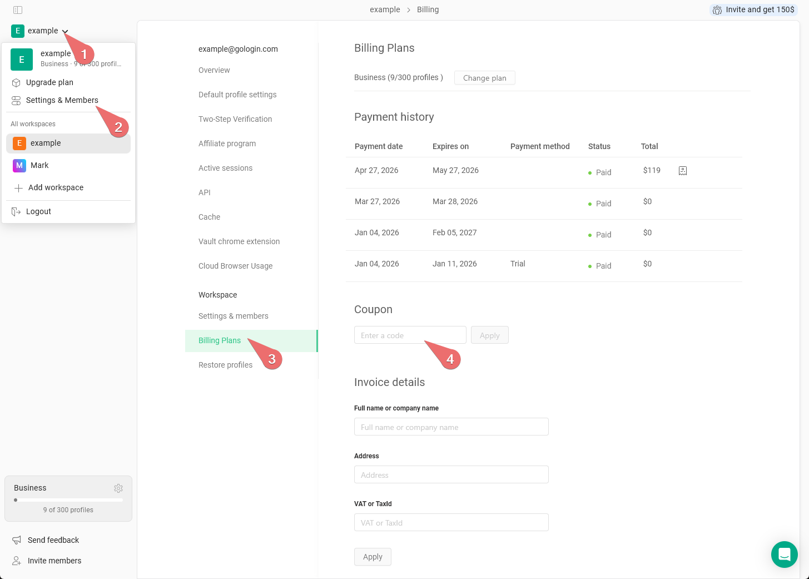

## Activar un código promocional

Si todavía no tienes una suscripción, puedes usar un código de cupón antes de la primera compra.

Para activarlo:

1. Ve a **main settings on the top-left** \> **Settings & Members**
2. Abre la pestaña **Billing plans**
3. En la sección **Coupon**, introduce el código promocional y haz clic en **Apply**
4. Ahora puedes elegir tu plan de suscripción haciendo clic en **Change plan**; el código promocional se aplicará al finalizar la compra.

<Frame>
  
</Frame>

## Cuándo se puede activar el código promocional

El código de cupón se puede activar si no has contratado ninguna suscripción anteriormente en la cuenta. Solo está disponible para la **primera suscripción mensual**.

**No hay códigos promocionales para la suscripción anual**, ya que esta ya incluye automáticamente un 50 % de descuento.

Los códigos promocionales funcionan con todos los [métodos de pago](/es/general/account-and-billing/payment-methods) disponibles **excepto PayPal**.

Los códigos promocionales no se pueden usar en los siguientes casos:

- si el código promocional no es válido o ha caducado
- si has usado un código promocional anteriormente
- si ya te has suscrito antes
- si intentas comprar una suscripción anual
- si intentas pagar con PayPal

## Dónde conseguir un código

Los códigos promocionales se pueden encontrar en varios lugares de internet, así que te recomendamos buscarlos en la web. Ten en cuenta que nuestro equipo de soporte no dispone de códigos promocionales, así que no hace falta insistirles a nuestros agentes :)
