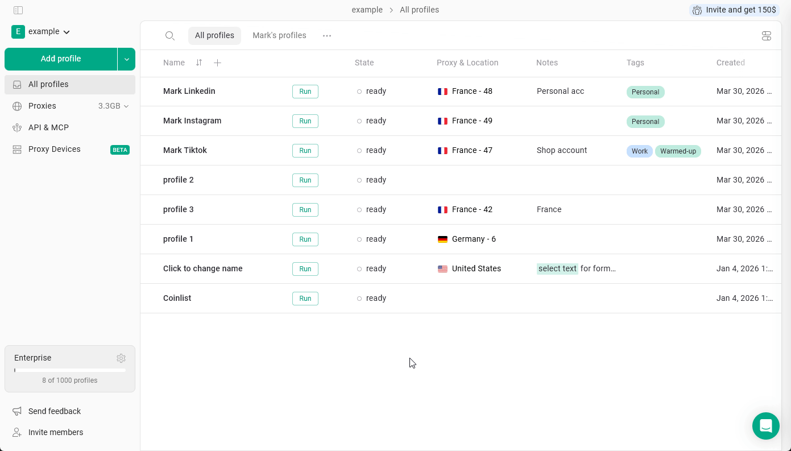
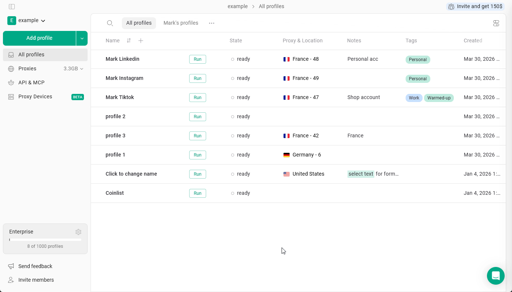

## Cómo invitar a miembros del equipo

<Info>
  **Nota:** si decides compartir el acceso al workspace, el miembro del equipo tendrá acceso a **todos** los perfiles y carpetas incluidos.
</Info>

Para empezar a colaborar con tu equipo y añadir miembros:

1. Haz clic en **Invite members**, en la esquina inferior izquierda
2. Introduce el **correo electrónico de tu compañero**
3. Selecciona el tipo de acceso: **Workspace** o **Selected Folders**
4. Elige el rol: **Can run**, **Can edit** o **Full access**
5. Haz clic en **Send invite**

<Frame>
  
</Frame>

La persona invitada recibirá una invitación por correo electrónico en su bandeja de entrada.\
Si tiene dudas sobre cómo acceder al workspace, comparte con ella [este artículo](/es/general/team-collaboration/accessing-shared-workspace-or-folders).

## Invitar con un enlace

En lugar de introducir un correo electrónico, puedes enviar un enlace de invitación, por ejemplo, a través de una aplicación de mensajería:

1. Haz clic en **Invite members**, en la esquina inferior izquierda
2. En la ventana **Invite team members**, haz clic en **Invite link**: el enlace se copia en el portapapeles
3. Envía el enlace a tu compañero

Cada enlace funciona solo una vez y es válido durante 24 horas. Si ha caducado o ya se ha usado, crea uno nuevo. Cuando alguien se una a tu workspace mediante un enlace, recibirás un correo electrónico al respecto.

Si ves el mensaje **You've reached the limit of team members**, primero añade una plaza de miembro del equipo; consulta [Team Members](/es/general/team-collaboration/team-members).

## Cambiar y revocar el acceso

Para cambiar o revocar el acceso al workspace:

1. Ve al **main menu**, en la esquina superior izquierda \> **Settings & Members**
2. **Localiza al miembro** en la pestaña Settings & Members \> **haz clic en su permiso**
3. **Cambia el permiso** según sea necesario
4. Para revocar el acceso al workspace, haz clic en **Remove member** en el menú de acceso

<Frame>
  
</Frame>
