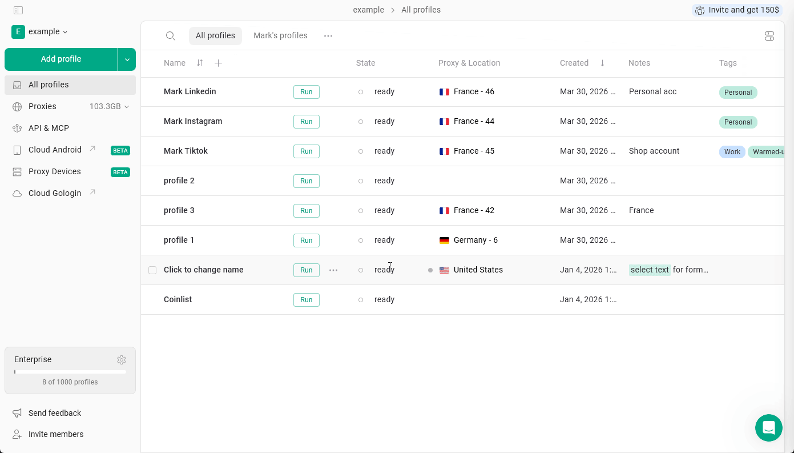
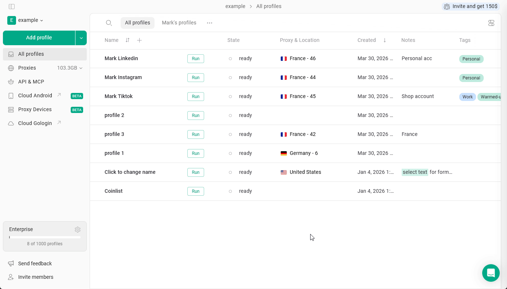
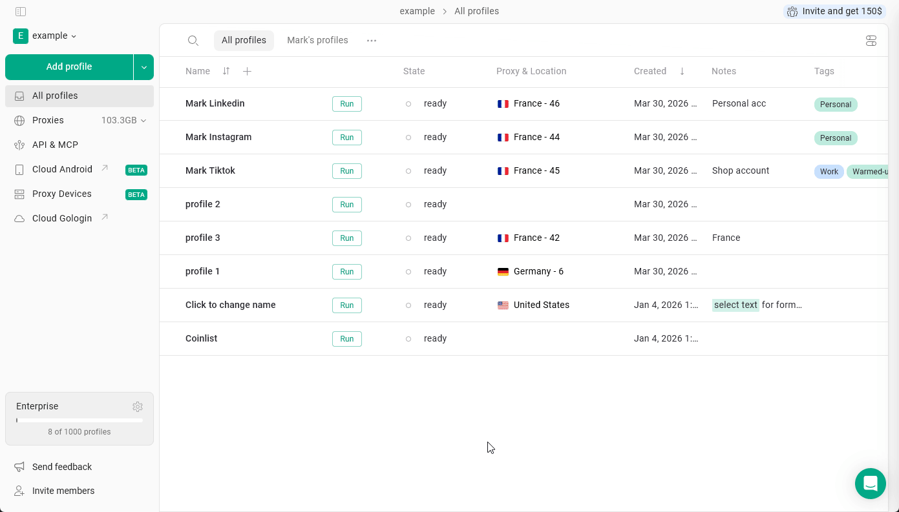

Pour vérifier si un profil contient des cookies, cliquez sur les **3 points** du profil \> **Cookies**.

Vous pouvez ici **importer**, **exporter** ou **supprimer** des cookies.

<Frame>
  
</Frame>

## Comment importer des cookies dans un profil Gologin

Gologin prend en charge les formats **JSON**, **Netscape** et **texte brut**. Il accepte les cookies exportés **directement depuis Gologin** ainsi que les fichiers de cookies créés par des **extensions Chrome tierces**, telles que EditThisCookie, Swap My Cookies, Cookie Editor, etc.

<Note>
  Si vous rencontrez des problèmes lors de l'import, vérifiez que les cookies fournis sont dans un format pris en charge.
</Note>

Pour effectuer l'import :

1. Cliquez sur les **3 points du profil** \> **Cookies**
2. Cliquez sur **Importer des cookies**
3. Cliquez sur l'**icône de fichier** ou **glissez-déposez votre fichier de cookies** dessus\
   vous pouvez aussi copier-coller les cookies en texte brut dans le champ situé en dessous
4. Cliquez sur **Importer**

<Frame>
  
</Frame>

Votre profil est prêt à être lancé 👍

<Note>
  Les cookies importés s'ajoutent à ceux déjà présents dans le profil : les cookies existants ne sont pas supprimés. Pour repartir de zéro, supprimez d'abord les cookies (**3 points** > **Cookies** > **Supprimer**).
</Note>

## Export de cookies

Pour exporter des cookies à l'aide du menu intégré :

1. Cliquez sur les **3 points du profil** \> **Cookies**
2. Cliquez sur **Exporter**
3. Choisissez le **Dossier** et cliquez sur **Sauvez**

<Frame>
  
</Frame>
