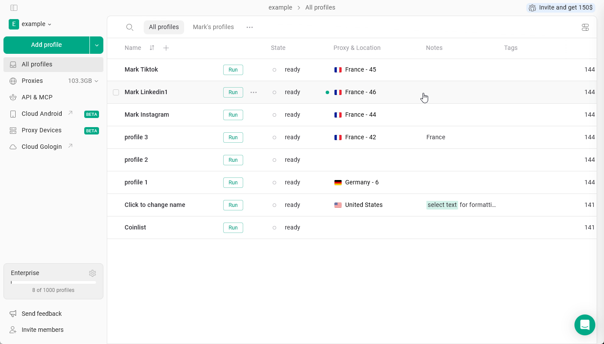
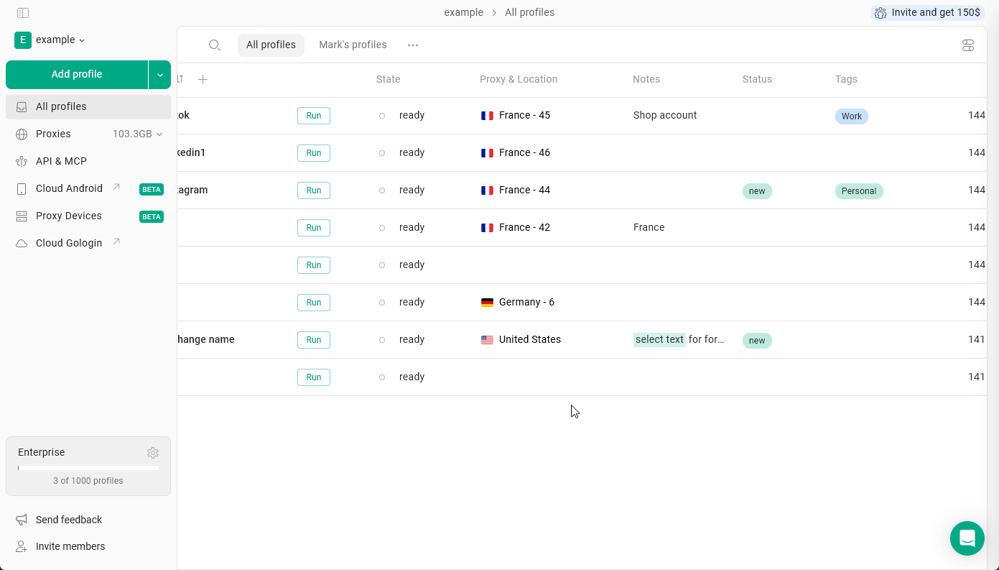
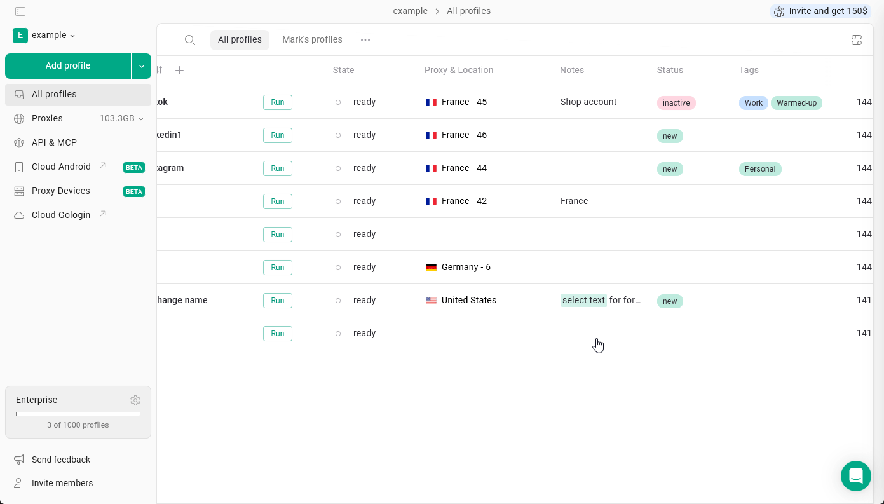
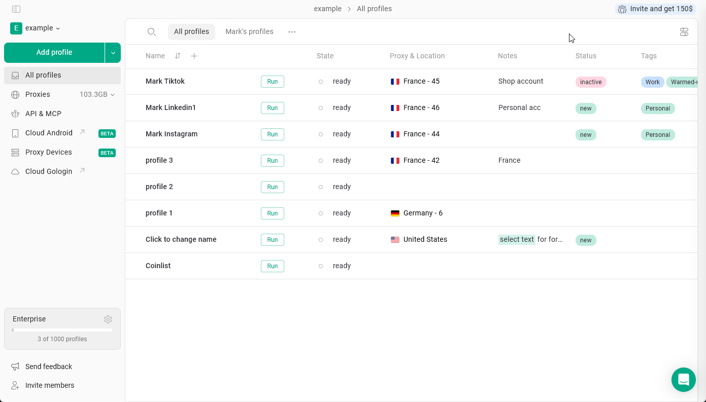

Ces champs de texte des profils aident les utilisateurs à différencier, filtrer et retrouver facilement leurs profils.

## Notes

Les **notes** dans Gologin vous permettent de stocker des informations supplémentaires directement dans chaque profil de navigateur. C'est utile pour conserver les détails d'un compte, des rappels ou tout contexte lié à un profil précis.

Pour **ajouter une note au profil**, cliquez simplement sur les notes du profil et commencez à écrire.

<Frame>
  
</Frame>

Les notes prennent en charge une **mise en forme** de base : **gras**, _italique_, ~~barré~~, couleur d'arrière-plan et <u>souligné</u>.  Sélectionnez le texte et appliquez la mise en forme !

## Les balises et Statut

**Les balises** vous permettent d'étiqueter les profils avec des mots-clés afin de les classer et de les filtrer par type de compte, plateforme ou projet, tandis que **Statut** affiche l'état d'avancement du flux de travail.

<Info>
  Ces champs sont masqués par défaut. Consultez [cette page](/fr/browser-profiles/profile-management/add-more-info-columns) pour savoir comment les activer dans les paramètres.
</Info>

<Tip>
  La principale différence est qu'un profil peut avoir plusieurs balises, mais un seul statut.
</Tip>

### Créer ou ajouter

Pour **créer une nouvelle balise ou un nouveau statut**, cliquez sur le champ correspondant dans le profil et commencez à écrire. Vous pouvez aussi choisir **une couleur** lors de la création ou de la modification : sélectionnez l'une des couleurs prédéfinies ou définissez **la vôtre** avec le sélecteur de couleur ou un code HEX.

Vous pouvez **attribuer des balises existantes** à un profil en les sélectionnant dans la liste.

<Frame>
  
</Frame>

### Filtrer par

Vous pouvez filtrer les profils par statut ou par balises. Pour cela, cliquez sur le champ correspondant et sélectionnez la balise ou le statut selon lequel vous souhaitez filtrer.

Pour effacer le filtre, cliquez sur la flèche à côté de la catégorie du champ.

<Frame>
  
</Frame>

### Modifier les balises et le statut

- Pour **supprimer** une balise ou un statut d'un profil : Cliquez sur le champ → cliquez sur **X** à côté de l'élément
- Pour **supprimer** complètement une balise ou un statut : Cliquez sur le champ → cliquez sur les **trois points** à côté de l'élément dans la liste → **Supprimer**

Vous pouvez également modifier les couleurs des balises et des statuts depuis cette liste.

<Frame>
  
</Frame>

## Travail en équipe

Ces champs se comportent différemment lorsque vous travaillez avec des profils, des dossiers et des espaces de travail partagés.

- **Les notes sont entièrement synchronisées**. Toute modification apportée aux notes est visible par tous les membres de l'équipe.
- **Les balises et le statut sont propres à chaque utilisateur**. Lorsque vous partagez un profil, les destinataires ne voient pas vos balises ni votre statut et peuvent attribuer les leurs selon leur flux de travail.

<Info>
  Les membres de l'équipe ont besoin de l'accès « peut modifier » pour changer les notes, le statut et les balises d'un profil
</Info>
