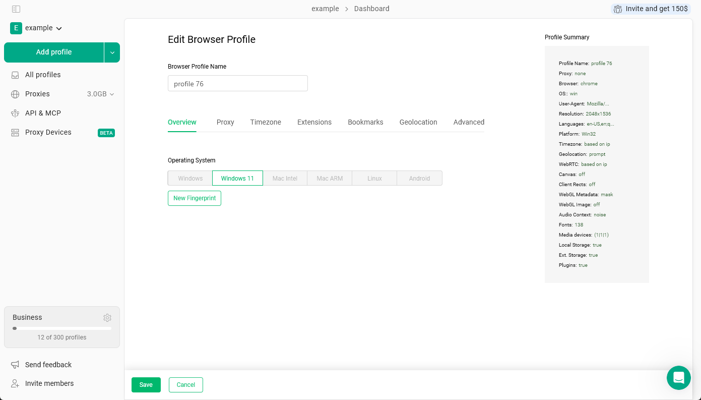
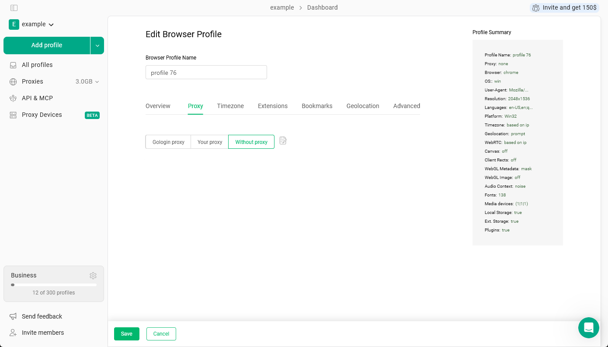
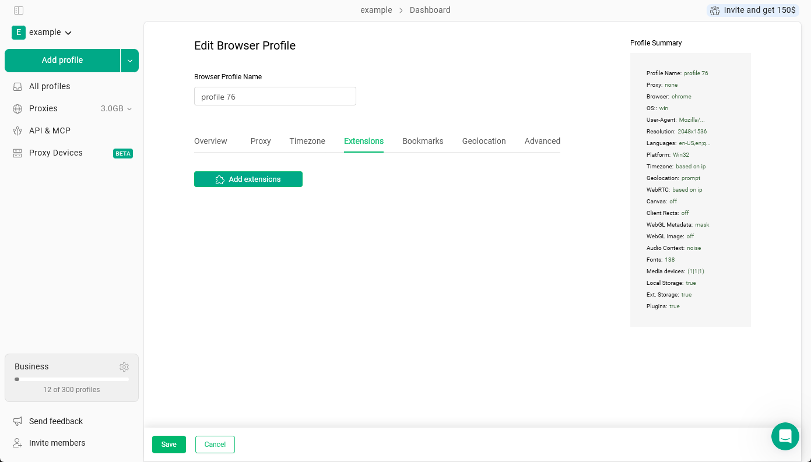
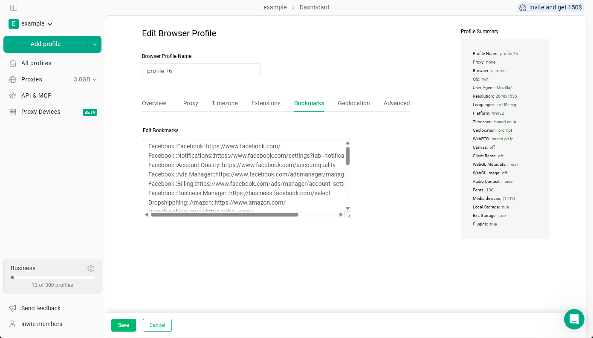
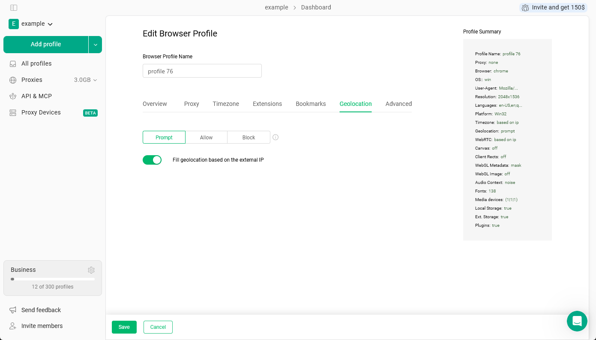

Chaque profil de navigateur dans Gologin possède son propre ensemble de paramètres qui définissent la façon dont il apparaît aux yeux des sites web. Ces paramètres sont répartis dans des onglets situés en haut de l’éditeur de profil.

Vous pouvez accéder aux paramètres du profil en cliquant sur **les 3 points du profil** \> **Paramètres**.

## Vue d’ensemble

Cet onglet permet de définir le système d’exploitation sous lequel le profil semblera fonctionner et de générer son fingerprint de base.

**Système d’exploitation** - Choisissez entre Windows 10, Windows 11, Mac Intel, Mac ARM, Linux et Android. Cela détermine le système d’exploitation que le profil indique à chaque site web visité.

<Warning>
  Le système d’exploitation ne peut être sélectionné que lors de la création d’un profil. Une fois le profil enregistré, cette option est verrouillée et ne peut plus être modifiée. Si vous avez besoin d’un autre système d’exploitation, créez un nouveau profil.
</Warning>

**Nouveau fingerprint** - Un clic sur ce bouton génère un nouvel ensemble de valeurs de fingerprint pour le profil : résolution d’écran, polices, informations graphiques et autres signaux que les sites web utilisent pour identifier les navigateurs. Utilisez-le si vous souhaitez réinitialiser l’identité du profil. Cela ne modifie pas le système d’exploitation et n’efface ni les cookies ni les autres données du navigateur.

Le panneau **Résumé du profil** à droite se met à jour au fur et à mesure de vos modifications et vous donne un aperçu rapide du fingerprint actuel du profil.

<Frame>
  
</Frame>

## Proxy

Cet onglet permet de choisir le proxy utilisé par le profil lors de la navigation.

- **Proxy Gologin** - Utilisez un proxy issu du service de proxys intégré de Gologin.
- **Votre mandataire** - Collez votre propre proxy provenant d’un fournisseur externe.
- **Sans procuration** - Le profil utilise votre connexion Internet réelle. L’adresse IP visible par les sites web sera votre véritable adresse IP.

<Frame>
  
</Frame>

Le proxy que vous attribuez ici détermine l’adresse IP que les sites web voient lorsque ce profil est en cours d’exécution. Il influe également sur le fuseau horaire et la géolocalisation si ceux-ci sont configurés pour suivre automatiquement l’adresse IP.

## Fuseau horaire

Cet onglet définit le fuseau horaire que le profil indique aux sites web.

Par défaut, l’option **Remplir le fuseau horaire en fonction de l’adresse IP externe** est activée, ce qui signifie que le profil utilise automatiquement le fuseau horaire correspondant à l’emplacement de son proxy. Cela garantit la cohérence interne du profil : un profil avec un proxy américain indiquera un fuseau horaire américain, comme le ferait un véritable utilisateur situé à cet endroit. Pour qu’un profil semble provenir d’un pays précis, ajoutez un proxy de ce pays et laissez le fuseau horaire et la géolocalisation basés sur l’adresse IP : Gologin les fait correspondre automatiquement à l’emplacement du proxy.

<Note>
  Il est recommandé de laisser cette option en mode automatique et de ne pas la modifier manuellement. Si le fuseau horaire ne correspond pas à l’emplacement du proxy, cela peut paraître suspect aux yeux des sites web. Ne le modifiez que si vous avez une raison précise de le faire.
</Note>

<Frame>
  
</Frame>

## Extensions

Cet onglet permet d’installer des extensions de navigateur dans le profil. Chaque profil gère ses extensions séparément : en ajouter une ici n’affecte aucun autre profil.

Cliquez sur **Ajouter des extensions** pour parcourir et installer des extensions pour ce profil.

Pour un guide complet sur le fonctionnement des extensions dans les profils Gologin, consultez [Extensions](/fr/browser-profiles/profile-features/browser-extensions/browser-extensions).

<Frame>
  
</Frame>

## Favoris

Cet onglet permet d’ajouter des favoris à la barre de favoris du profil. Collez-les dans le champ de texte en utilisant l’un de ces formats :

- `folder::name::url` - crée un favori dans un dossier nommé
- `name::url` - crée un favori nommé directement dans la barre
- `url` - ajoute directement l’URL sans nom personnalisé

Chaque ligne correspond à un favori distinct. Ils apparaissent dans la barre de favoris d’Orbita lorsque le profil est en cours d’exécution.

<Frame>
  
</Frame>

## Géolocalisation

Cet onglet contrôle ce qui se passe lorsqu’un site web demande votre position, par exemple lorsqu’une application de cartes affiche « Autoriser ce site à connaître votre position ? »

Il existe trois options :

- **Demander** - Le navigateur vous interroge à chaque fois qu’un site demande l’accès à la position. C’est l’option par défaut, qui reproduit le comportement d’un vrai navigateur.
- **Autoriser** - L’accès à la position est automatiquement accordé à tout site qui le demande.
- **Bloquer** - Toutes les demandes de localisation sont refusées sans notification.

L’option **Remplir la géolocalisation en fonction de l’adresse IP externe** est activée par défaut. Lorsqu’elle est activée, Gologin définit automatiquement les coordonnées indiquées par le profil pour qu’elles correspondent à l’emplacement du proxy.

<Note>
  Il est recommandé de laisser cette option activée. Si vous la désactivez et que la géolocalisation ne correspond pas à l’adresse IP du proxy, cette incohérence peut constituer un signal pour les systèmes de détection. Ne l’ajustez manuellement que si vous savez quelles coordonnées vous souhaitez utiliser et pourquoi.
</Note>

<Frame>
  
</Frame>
