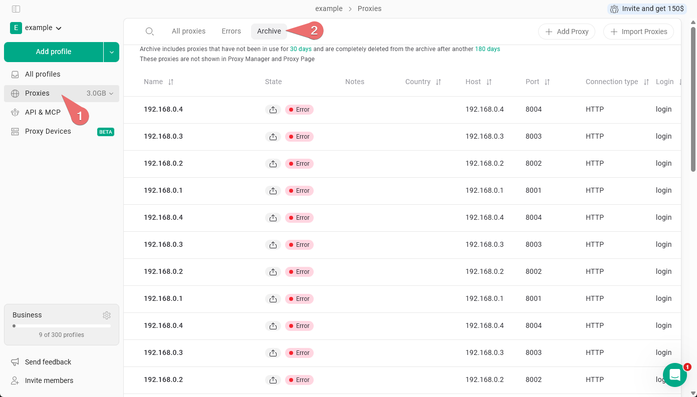
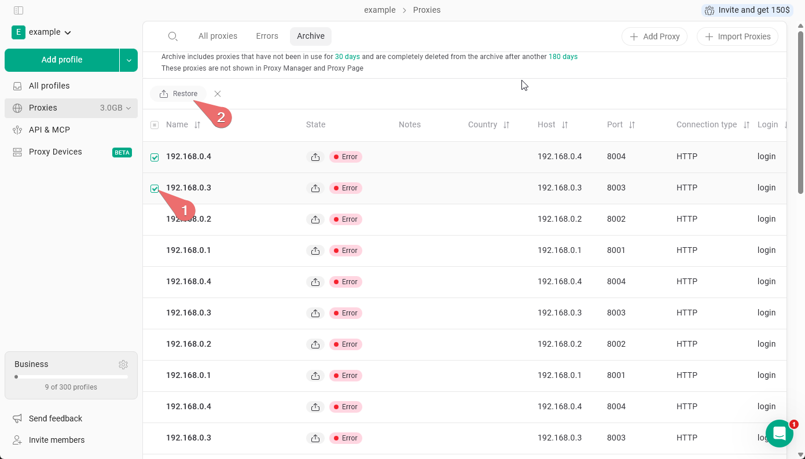

L'**Archive des proxys** est l'endroit où Gologin déplace automatiquement les proxys qui ne sont plus utilisés. Pour l'ouvrir, allez dans **Proxies** dans la barre latérale gauche, puis cliquez sur l'onglet **Archive**.

Un proxy est déplacé vers l'archive après **30 jours** sans utilisation. Les proxys archivés ne sont pas visibles dans le gestionnaire de proxys ni sur la page principale Proxies : ils n'encombrent donc pas votre liste de proxys actifs.

Si un proxy reste dans l'archive sans être utilisé, il est définitivement supprimé après **180 jours** supplémentaires.

<Note>
  Avec le plan Forever Free et la période d'essai, votre compte peut contenir jusqu'à **50 proxys**, y compris les proxys présents dans l'archive. Pour en ajouter de nouveaux, supprimez les proxys dont vous n'avez pas besoin, y compris dans l'archive.
</Note>

<Frame>
  
</Frame>

## Restaurer des proxys depuis l'archive des proxys

Pour restaurer un proxy, sélectionnez-le à l'aide de la case à cocher, puis cliquez sur **Restaurer**. Vous pouvez sélectionner plusieurs proxys et tous les restaurer en une seule fois.

<Frame>
  
</Frame>
