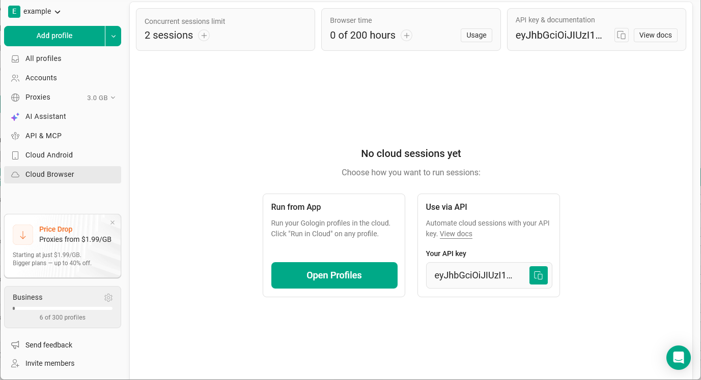
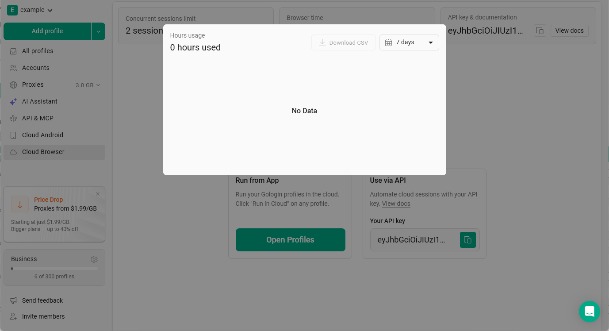
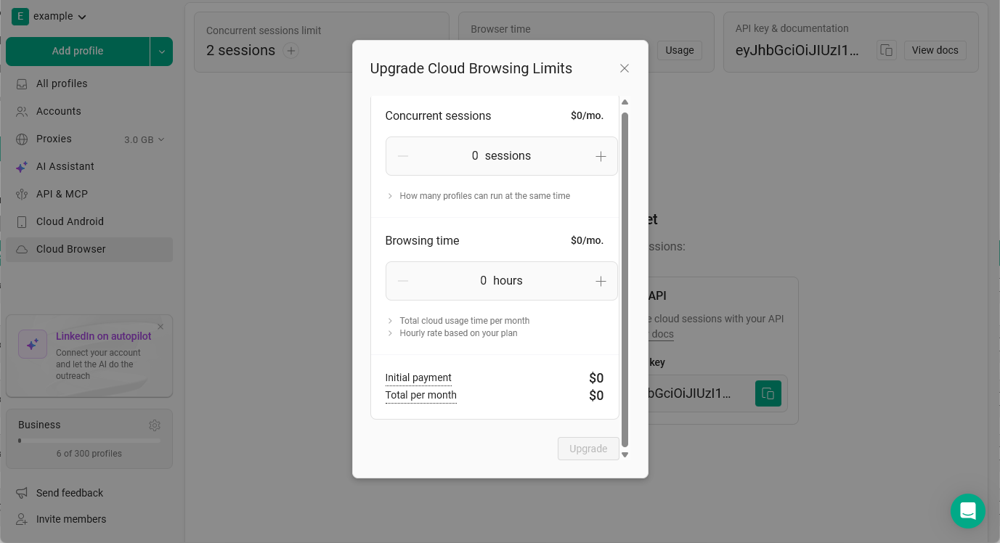

The **Cloud Browser** dashboard shows your cloud browser limits and usage - for profiles launched with **Run in Cloud**, in the web app or through the Cloud Browser API - and lets you buy more cloud limits.

To open it, click **Cloud Browser** in the left menu.

## What you'll find there

At the top of the page:

- **Concurrent sessions limit** - how many cloud profiles can run at the same time. Click **\+** to buy more sessions.
- **Browser time** - cloud hours used this month out of your monthly limit, for example **0 of 200 hours**. Click **\+** to buy more hours or **Usage** to see statistics.
- **API key & documentation** - the token for the Cloud Browser API. Click the copy icon to copy it or **View docs** to open the API documentation.

If you haven't run any cloud profiles yet, the page shows two ways to start:

- **Run from App** - click **Open Profiles**, then **Run in Cloud** on any profile.
- **Use via API** - copy **Your API key** and click **View docs** to see how to use it.

### Usage statistics

Click **Usage** in the **Browser time** block to see how many cloud hours you've used. Choose the period in the top-right corner, for example **7 days**, and click **Download CSV** to download the data.

## Buying more cloud limits

Click **\+** next to **Concurrent sessions limit** or **Browser time**. In the **Upgrade Cloud Browsing Limits** window, choose what you need:

- **Concurrent sessions** - **\$2 per session per month**. Sets how many profiles can run in the cloud at the same time.
- **Browsing time** - extra cloud hours per month. The hourly rate depends on your plan: **\$0.09** on Professional, **\$0.08** on Business, **\$0.07** on Enterprise and **\$0.05** on Custom plans.

The window shows how much you pay now (**Initial payment**) and how much per month (**Total per month**). Click **Upgrade** to pay. Additional cloud limits can be paid only through **Stripe** - PayPal and crypto aren't available for them.

### How billing for extra limits works

The price of extra limits is the same for monthly and annual plans, but you're charged differently:

- **Monthly plan** - you pay for the extra limits only until the end of your current billing period. After that, they renew together with your plan.
- **Annual plan** - you pay for one month at a time. Extra limits are then charged separately every month until your annual plan ends.

<Note>
  Cloud browser profiles and extra cloud limits are available on paid plans only.
</Note>
