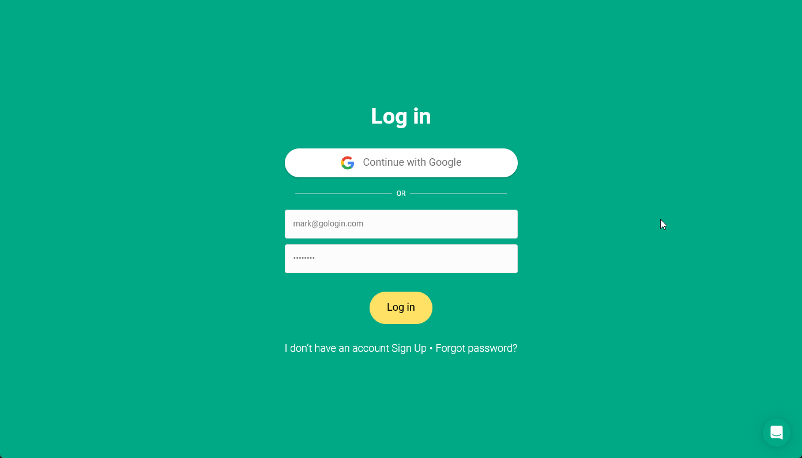

If you have been invited to a **workspace** or **shared folder**, you can access it after accepting the invitation sent to your email or opening an invite link.

<Note>
  You will need to go to the owner's workspace to work with the shared workspace or shared folders.
</Note>

## If you are not registered yet

1. Open your **email inbox** and find the invitation message from **Gologin**
2. Click the **invitation link** in the email
3. Create your **Gologin account** by following the registration steps

After registration, you will automatically gain access to the shared workspace.

## If you got an invite link

Open the link, then log in to your Gologin account or create one. The shared workspace will appear in the **main menu** in the top-left of the app.

The link works only once and is valid for 24 hours. If it doesn't work, ask the workspace owner for a new link.

## If you already have a Gologin account

1. Log in to your **Gologin account** using your credentials or **Google authentication**
2. Open the **main menu** in the top-left of the app
3. Locate the shared workspace listed under your **account**
4. Click the workspace to open it

<Frame>
  
</Frame>

Once selected, you will be able to access the profiles and folders shared with you.

## Navigating shared workspaces and folders

In case you've been shared access to the whole workspace, you will see all the available folders in the top folder row. The All profiles section includes all the profiles with and without a folder.

If you've been shared the specific folders only, you will only see profiles from this folder in the All profiles section. You're able to create new profiles only inside the folder, that is if you have the editing access.

If you see 0 profiles, you may have access only to a folder that has no profiles. Ask the owner to give you access to the workspace or the right folder, then log out and log in again.
