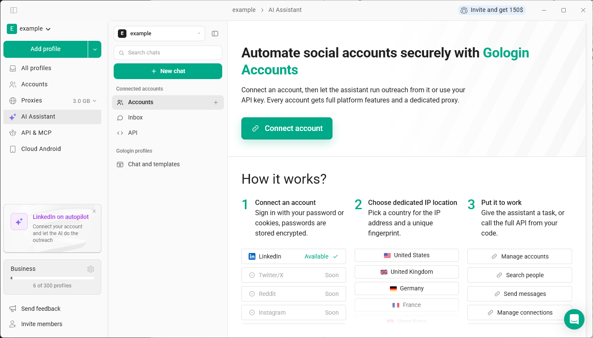

**接続アカウント**（アプリ内の **アカウント** セクション）を使うと、LinkedInアカウントを一度Gologinに接続するだけで、そのアカウントからアウトリーチを実行できます。人物の検索、招待やメッセージの送信、返信への対応、投稿やコメントの公開が可能です。

接続したアカウントには、それぞれ次のものが用意されます。

- 固有のフィンガープリントを持つ専用のGologinブラウザプロファイル
- 選択した国の専用IP、またはお持ちのプロキシ
- ログイン状態が維持されるセッション。アカウントはクラウド上で動作するため、パソコンの電源を切ってもタスクは実行され続けます。

接続アカウントはブラウザプロファイルとは異なります。プロファイルは、ご自身または[AIアシスタント](/ja/ai/ai-assistant)が作業する独立したブラウザです。接続アカウントの場合は、タスクを指示すると、Gologinがそのアカウント専用のプロファイルを使って操作を実行します。

## アカウントの利用方法

- **AIアシスタント。** 「ベルリンのSaaS企業のグロース責任者を招待して」のように、1文で作業内容を伝えます。アシスタントがプランを提示し、承認するまでは何も送信しません。詳しくは[AIアシスタントによるアウトリーチ](/ja/ai/connected-accounts/assistant-and-inbox)をご覧ください。
- **受信トレイ。** すべてのアカウントへの返信が1つのリストに集約され、返信はメッセージを受信したアカウントから送信されます。
- **API。** 同じ制限の範囲内で、ご自身のコードやAIエージェントから同じアカウントを操作できます。詳しくは[接続アカウントAPI](/ja/ai/connected-accounts/api)をご覧ください。

## 対応しているネットワーク

現在利用できるのは **LinkedIn** です。Twitter/X、Reddit、Instagram、Gmail、WhatsApp、Telegramは近日対応予定です。

## シートとアーリーアクセス

接続アカウントは、ステータスに関係なく、ワークスペースのシートを1つ使用します。アカウントの接続を解除してもシートは保持されます。アカウントを削除した場合にのみ、シートが解放され、別のアカウントに使えるようになります。アプリとAPIでシートは共通です。

接続アカウントはアーリーアクセス期間中は無料で、1ワークスペースあたり最大3アカウントまで、カード登録なしで接続できます。それ以上のアカウントを試したい場合は、[接続アカウントのページ](https://gologin.com/connected-accounts/)からデモを予約してください。

## 利用できる場所

Gologinアプリの左メニューで **アカウント** をクリックするか、**AIアシスタント** を開いて、**接続アカウント** の下にある **アカウント**、**受信トレイ**、**API** を使用します。

## 次のステップ

- [LinkedInアカウントを接続する](/ja/ai/connected-accounts/connect-linkedin)
- [AIアシスタントによるアウトリーチ](/ja/ai/connected-accounts/assistant-and-inbox)
- [制限とウォームアップ](/ja/ai/connected-accounts/limits)
- [接続アカウントAPI](/ja/ai/connected-accounts/api)
