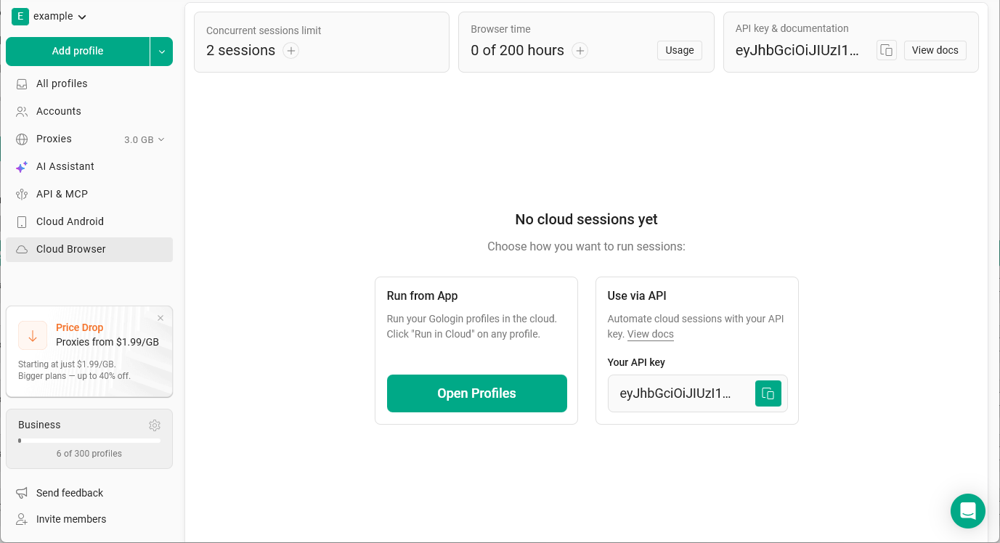
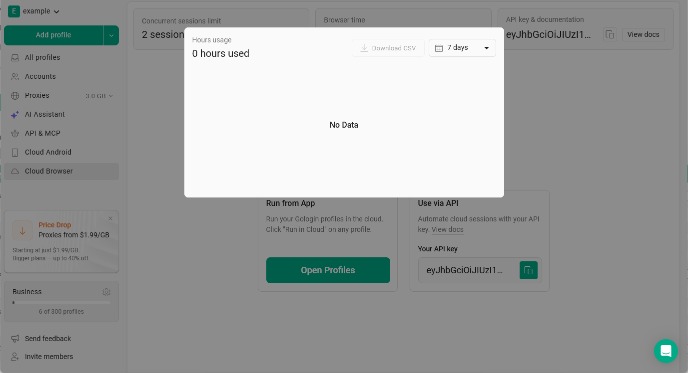
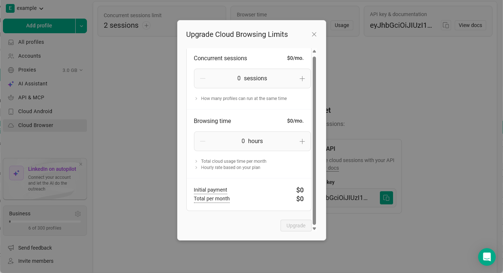

**Cloud Browser** ダッシュボードでは、**Run in Cloud**（Webアプリまたは Cloud Browser API 経由）で起動したプロファイルについて、クラウドブラウザの上限と利用状況を確認でき、クラウドの上限を追加購入することもできます。

開くには、左側のメニューで **Cloud Browser** をクリックします。

## このページで確認できる内容

ページ上部には次の項目があります。

- **Concurrent sessions limit** - 同時に実行できるクラウドプロファイルの数です。**\+** をクリックするとセッションを追加購入できます。
- **Browser time** - 今月使用したクラウド時間と月間上限です（例: **0 of 200 hours**）。**\+** をクリックすると時間を追加購入でき、**Usage** をクリックすると統計を確認できます。
- **API key & documentation** - Cloud Browser API 用のトークンです。コピーアイコンをクリックするとコピーでき、**View docs** をクリックすると API ドキュメントが開きます。

まだクラウドプロファイルを実行したことがない場合は、ページに次の2つの始め方が表示されます。

- **Run from App** - **Open Profiles** をクリックし、任意のプロファイルで **Run in Cloud** をクリックします。
- **Use via API** - **Your API key** をコピーし、**View docs** をクリックして使い方を確認します。

### 利用統計

**Browser time** ブロックの **Usage** をクリックすると、使用したクラウド時間を確認できます。右上で期間（例: **7 days**）を選択し、**Download CSV** をクリックするとデータをダウンロードできます。

## クラウドの上限を追加購入する

**Concurrent sessions limit** または **Browser time** の横にある **\+** をクリックします。**Upgrade Cloud Browsing Limits** ウィンドウで、必要な項目を選択します。

- **Concurrent sessions** - **1セッションあたり月額 \$2**。クラウドで同時に実行できるプロファイルの数を設定します。
- **Browsing time** - 毎月の追加クラウド時間です。1時間あたりの料金はプランによって異なり、Professional は **\$0.09**、Business は **\$0.08**、Enterprise は **\$0.07**、Custom プランは **\$0.05** です。

ウィンドウには、今回のお支払い額（**Initial payment**）と毎月のお支払い額（**Total per month**）が表示されます。**Upgrade** をクリックして支払います。追加のクラウド上限のお支払いは **Stripe** のみ対応しており、PayPal や暗号資産は利用できません。

### 追加上限の課金の仕組み

追加上限の価格は月払いプランでも年払いプランでも同じですが、請求方法が異なります。

- **月払いプラン** - 追加上限の料金は、現在の請求期間の終了までのみお支払いいただきます。その後は、プランと一緒に更新されます。
- **年払いプラン** - 1か月分ずつお支払いいただきます。追加上限は、年払いプランが終了するまで毎月別途請求されます。

<Note>
  クラウドブラウザプロファイルと追加のクラウド上限は、有料プランでのみ利用できます。
</Note>
