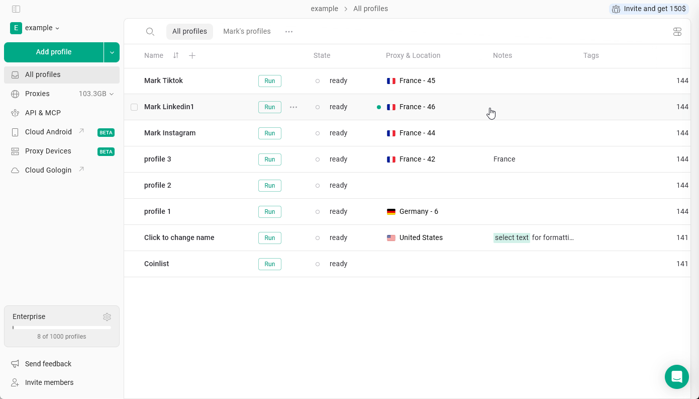
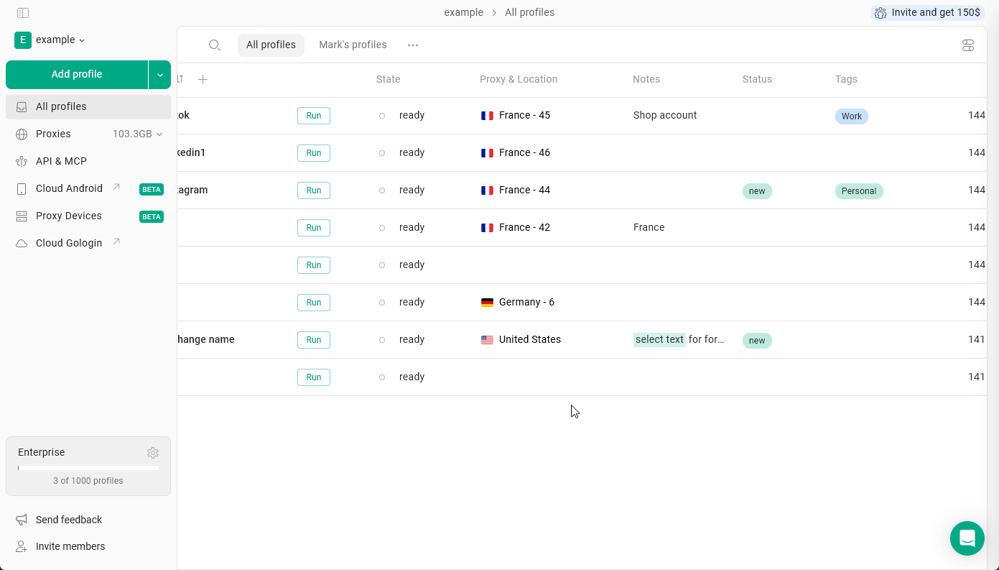
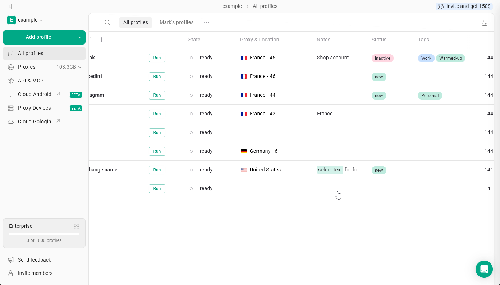
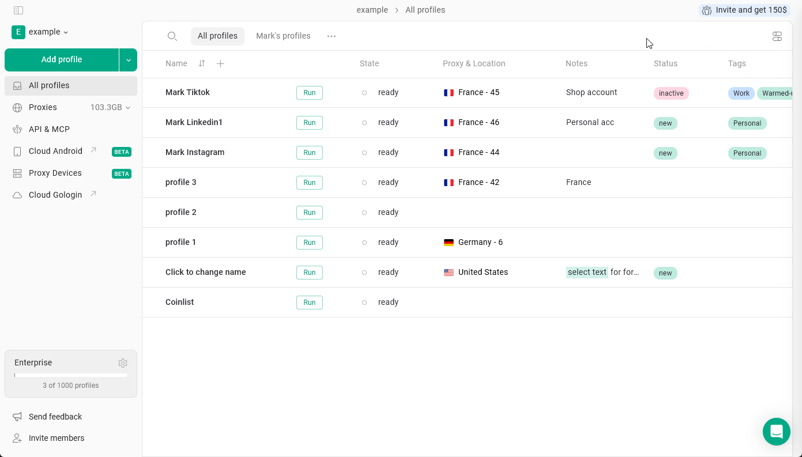

Te tekstowe pola profilu pomagają łatwo rozróżniać, filtrować i wyszukiwać profile.

## Notes

Funkcja **Notes** w Gologin pozwala przechowywać dodatkowe informacje bezpośrednio w każdym profilu przeglądarki. Jest to przydatne do zapisywania danych konta, przypomnień lub dowolnego kontekstu związanego z konkretnym profilem.

Aby **dodać notatkę do profilu**, kliknij notatki profilu i zacznij pisać.

<Frame>
  
</Frame>

Notatki obsługują podstawowe **formatowanie**, w tym **pogrubienie**, _kursywę_, ~~przekreślenie~~, kolor tła i <u>podkreślenie</u>.  Zaznacz tekst i zastosuj formatowanie!

## Tags and Status

Funkcja **Tags** pozwala oznaczać profile słowami kluczowymi, aby ułatwić ich kategoryzowanie i filtrowanie według typu konta, platformy lub projektu, natomiast **Status** pokazuje etap procesu pracy.

<Info>
  Te pola są domyślnie ukryte. Odwiedź [tę stronę](/pl/browser-profiles/profile-management/add-more-info-columns), aby dowiedzieć się, jak włączyć je w ustawieniach.
</Info>

<Tip>
  Kluczowa różnica polega na tym, że profil może mieć wiele tagów, ale tylko jeden status.
</Tip>

### Tworzenie i dodawanie

Aby **utworzyć nowy tag lub status**, kliknij odpowiednie pole w profilu i zacznij pisać. Podczas tworzenia lub edycji możesz też wybrać **kolor**: wybierz jeden z gotowych kolorów albo ustaw **własny** za pomocą próbnika kolorów lub kodu HEX.

Możesz **przypisać istniejące tagi** do profilu, wybierając je z listy.

<Frame>
  
</Frame>

### Filtrowanie

Profile można filtrować według statusu lub tagów. Aby to zrobić, kliknij odpowiednie pole i wybierz tag lub status, według którego chcesz filtrować.

Aby wyczyścić filtr, kliknij strzałkę obok kategorii pola.

<Frame>
  
</Frame>

### Modyfikowanie tagów i statusu

- Aby **usunąć** tag lub status z profilu: Kliknij pole → kliknij **X** obok elementu
- Aby **całkowicie usunąć** tag lub status: Kliknij pole → kliknij **trzy kropki** obok elementu na liście → **Delete**

Z tej listy możesz również zmieniać kolory tagów i statusów.

<Frame>
  
</Frame>

## Praca zespołowa

Te pola działają inaczej podczas pracy ze współdzielonymi profilami, folderami i przestrzeniami roboczymi.

- **Notatki są w pełni synchronizowane**. Wszelkie zmiany w notatkach są widoczne dla wszystkich członków zespołu.
- **Tagi i status są przypisane do użytkownika**. Gdy udostępniasz profil, odbiorcy nie zobaczą Twoich tagów ani statusu i mogą przypisać własne, zależnie od swojego procesu pracy.

<Info>
  Aby zmieniać notatki, status i tagi profilu, członkowie zespołu potrzebują dostępu "can edit"
</Info>
