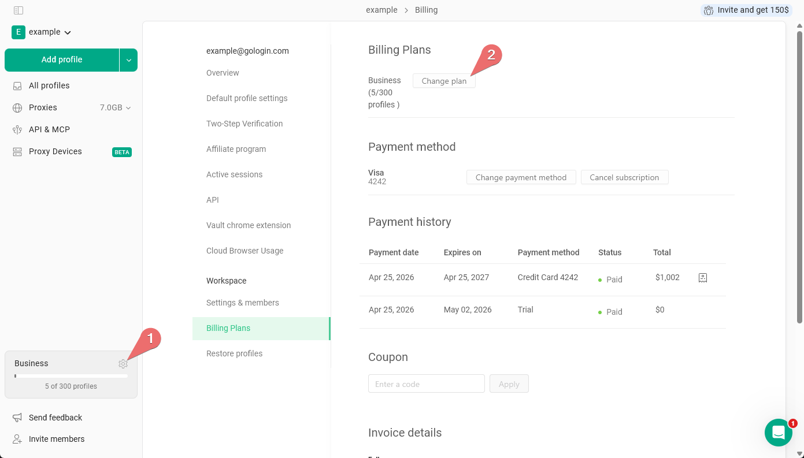
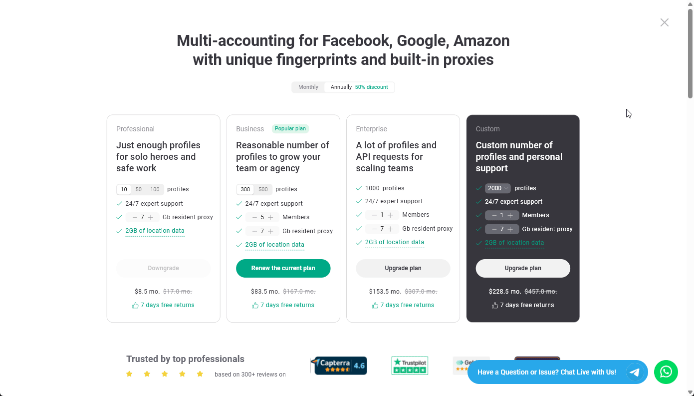

Zmiana subskrypcji może być potrzebna, jeśli:

- chcesz przejść na wyższy poziom obecnej subskrypcji,
- chcesz dodać do swojego planu funkcję [Team members](/pl/general/team-collaboration/team-members) lub dokupić dodatkowe miejsca dla członków zespołu,
- wiesz mniej więcej, ile ruchu proxy Gologin zużywasz co miesiąc, i chcesz, aby był on dodawany automatycznie.

## Zmiana poziomu planu subskrypcji

<Note>
  Możesz przejść tylko z jednej subskrypcji rocznej na inną subskrypcję roczną, nie miesięczną.
</Note>

**Jak to działa.** Gdy zmieniasz poziom planu (na przykład z Business na Enterprise):

- Koszt obecnego planu oraz liczba dni, które już wykorzystałeś, są uwzględniane jako **Proration discount**
- Nowa data odnowienia to data zmiany planu

Zanim zapłacisz, sprawdź okno ulepszenia planu: pokazuje ono **Proration discount** oraz sposób pokrycia różnicy w cenie – albo kwotą pobraną od razu, albo zmianą daty zakończenia planu (na przykład *plan zakończy się za 20 dni zamiast za 30*).

Aby ulepszyć obecny plan, wykonaj następujące kroki:

1. **Otwórz stronę z cennikiem**
   - Na głównej stronie All profiles **kliknij ikonę koła zębatego** obok informacji o planie \> kliknij **Change plan**.
     <Frame>
       
     </Frame>
2. **Wybierz nowy plan**
   - Określ liczbę członków zespołu i ilość ruchu proxy, a następnie kliknij **Upgrade plan** przy wybranej opcji subskrypcji.
   - Wybierz **payment method** i przejdź do płatności, klikając **Pay now**.
     <Frame>
       
     </Frame>
3. **Dokończ płatność i zacznij korzystać z Gologin**\
   Po zakończeniu płatności Twój plan subskrypcji zostanie wkrótce ulepszony.

## Dodawanie członków zespołu i ruchu proxy do obecnego planu

**Jak to działa:**

- Liczba dni subskrypcji, które już wykorzystałeś, jest uwzględniana jako **Proration discount**
- Data odnowienia pozostaje bez zmian

Aby dokupić dodatki do obecnego planu:

1. **Otwórz stronę z cennikiem**
   - Na głównej stronie All profiles **kliknij ikonę koła zębatego** obok informacji o planie \> kliknij **Change plan**.
     <Frame>
       
     </Frame>
2. **Wybierz nowe dodatki**
   - Sprawdź swój obecny plan – powinien mieć przycisk **Renew the current plan**.
   - Dodaj kolejne miejsca dla członków zespołu lub ruch proxy.
   - Wybierz **payment method** i przejdź do płatności, klikając **Pay now**.
     <Frame>
       
     </Frame>
3. **Dokończ płatność i zacznij korzystać z Gologin**\
   Po zakończeniu płatności Twój plan subskrypcji zostanie wkrótce zaktualizowany.
