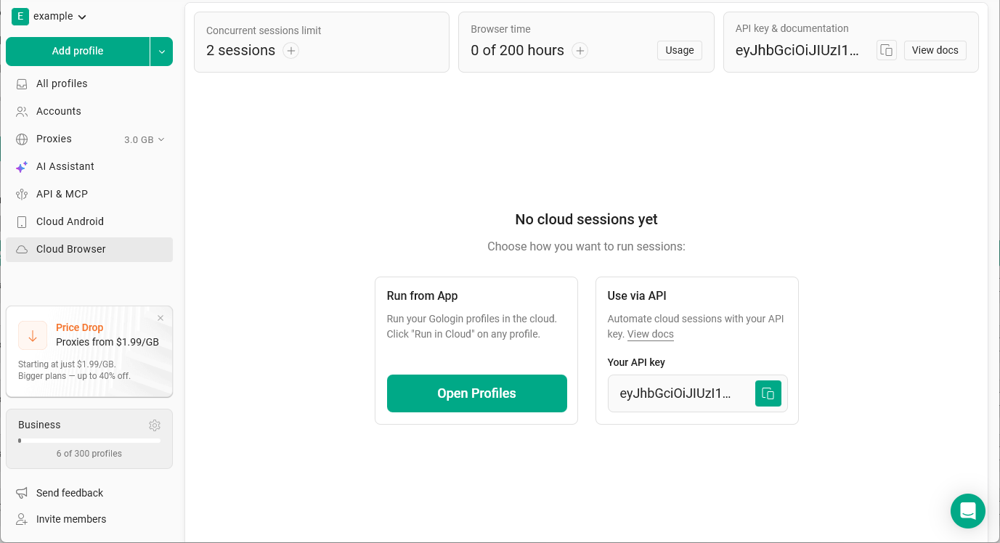
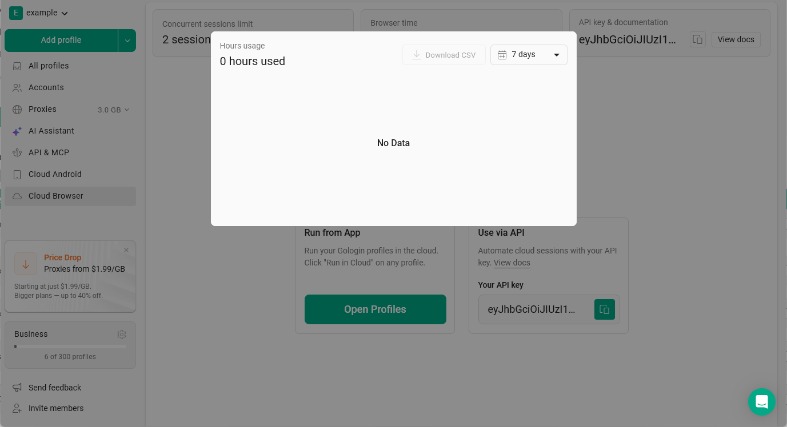
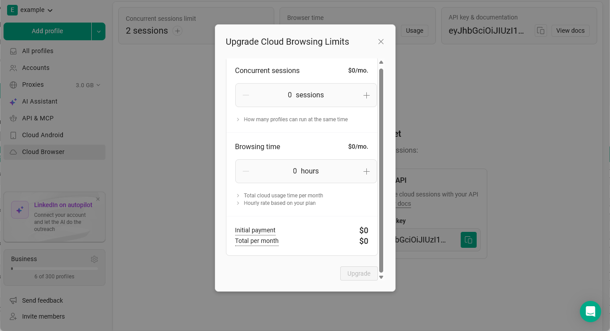

Panel **Cloud Browser** pokazuje Twoje limity i użycie przeglądarki w chmurze - dla profili uruchamianych przez **Run in Cloud**, w aplikacji webowej lub przez Cloud Browser API - i pozwala dokupić dodatkowe limity chmurowe.

Aby go otworzyć, kliknij **Cloud Browser** w menu po lewej stronie.

## Co znajdziesz na tej stronie

W górnej części strony:

- **Concurrent sessions limit** - ile profili w chmurze może działać jednocześnie. Kliknij **\+**, aby dokupić sesje.
- **Browser time** - godziny chmurowe wykorzystane w tym miesiącu z Twojego miesięcznego limitu, na przykład **0 of 200 hours**. Kliknij **\+**, aby dokupić godziny, lub **Usage**, aby zobaczyć statystyki.
- **API key & documentation** - token do Cloud Browser API. Kliknij ikonę kopiowania, aby go skopiować, lub **View docs**, aby otworzyć dokumentację API.

Jeśli nie uruchomiłeś jeszcze żadnego profilu w chmurze, strona pokazuje dwa sposoby na start:

- **Run from App** - kliknij **Open Profiles**, a następnie **Run in Cloud** przy dowolnym profilu.
- **Use via API** - skopiuj **Your API key** i kliknij **View docs**, aby zobaczyć, jak go użyć.

### Statystyki użycia

Kliknij **Usage** w bloku **Browser time**, aby zobaczyć, ile godzin chmurowych wykorzystałeś. Wybierz okres w prawym górnym rogu, na przykład **7 days**, i kliknij **Download CSV**, aby pobrać dane.

## Dokupowanie limitów chmurowych

Kliknij **\+** obok **Concurrent sessions limit** lub **Browser time**. W oknie **Upgrade Cloud Browsing Limits** wybierz, czego potrzebujesz:

- **Concurrent sessions** - **\$2 za sesję miesięcznie**. Określa, ile profili może działać w chmurze w tym samym czasie.
- **Browsing time** - dodatkowe godziny chmurowe miesięcznie. Stawka godzinowa zależy od planu: **\$0.09** w planie Professional, **\$0.08** w planie Business, **\$0.07** w planie Enterprise i **\$0.05** w planach Custom.

Okno pokazuje, ile płacisz teraz (**Initial payment**) i ile miesięcznie (**Total per month**). Kliknij **Upgrade**, aby zapłacić. Dodatkowe limity chmurowe można opłacić wyłącznie przez **Stripe** - PayPal i kryptowaluty nie są dla nich dostępne.

### Jak działa rozliczanie dodatkowych limitów

Cena dodatkowych limitów jest taka sama w planach miesięcznych i rocznych, ale sposób naliczania opłat się różni:

- **Plan miesięczny** - płacisz za dodatkowe limity tylko do końca bieżącego okresu rozliczeniowego. Potem są odnawiane razem z Twoim planem.
- **Plan roczny** - płacisz za jeden miesiąc naraz. Dodatkowe limity są następnie rozliczane osobno co miesiąc, aż do końca planu rocznego.

<Note>
  Profile przeglądarki w chmurze i dodatkowe limity chmurowe są dostępne tylko w planach płatnych.
</Note>
