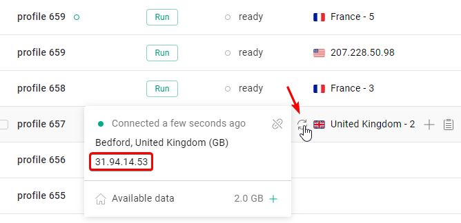
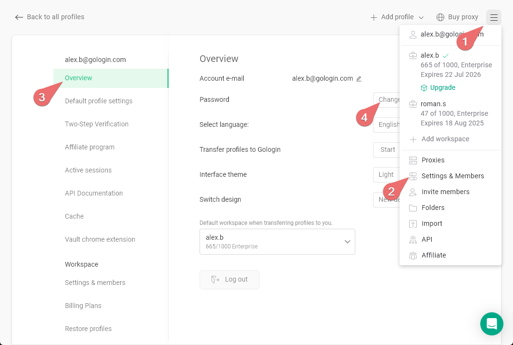

## **Dlaczego tak się dzieje i jak to działa?**

Różne strony internetowe korzystają z różnych baz danych geolokalizacji IP, aby określić kraj, do którego należy dany adres IP. Bazy te nie są ze sobą zsynchronizowane, dlatego ten sam adres IP może zostać przypisany do kilku różnych lokalizacji.

Drugim istotnym czynnikiem jest to, czy adres IP został oznaczony jako należący do centrum danych (Datacenter), VPN lub innej usługi. Jeśli adres IP zostanie rozpoznany jako usługa, jego wskaźnik zaufania może drastycznie spaść, przez co strony internetowe chętniej go oznaczą lub zablokują.

Nie zalecamy korzystania z serwerów proxy, w przypadku których występują wymienione powyżej rozbieżności.

## **Jak Gologin określa lokalizację proxy**

Sprawdzanie proxy w Gologin korzysta z jednej zewnętrznej bazy danych GeoIP. Gdy ta baza zostanie zaktualizowana, kraj wyświetlany dla danego adresu IP może się zmienić. W przypadku nowych serwerów proxy dane o lokalizacji w bazach GeoIP mogą nie być jeszcze aktualne, więc kraj może różnić się od tego, który został zakupiony - skontaktuj się wtedy z dostawcą proxy. Nie możesz zmienić bazy danych używanej przez Gologin; jeśli strona wymaga konkretnego kraju, użyj proxy, które jest konsekwentnie wykrywane jako pochodzące z tego kraju.

## **Jak sprawdzić proxy?**

1. Sprawdź wychodzący adres IP swojego proxy tutaj - wystarczy najechać kursorem na ikonę strzałek 
2. W internecie jest więcej narzędzi, ale my zazwyczaj używamy tych dwóch, ponieważ dają spójne wyniki:
   - Do sprawdzenia geolokalizacji IP: [<u>https://www.iplocation.net/ip-lookup</u>](https://www.iplocation.net/ip-lookup)

     ❗Idealnie byłoby, gdyby wszystkie narzędzia pokazywały ten sam kraj
   - Do sprawdzenia usług powiązanych z adresem IP: [<u>https://whatismyipaddress.com/ip/</u>](https://whatismyipaddress.com/ip/)

     ❗Nie powinno być wskazane żadne powiązanie adresu IP z usługami

   Przykłady do porównania znajdziesz poniżej: 

## **Jak uniknąć problemów z proxy**

Aby ograniczyć problemy wynikające z nieprawidłowej lokalizacji proxy:

- **Korzystaj z renomowanych dostawców proxy** – Dobrej jakości dostawcy dbają o to, aby ich adresy IP były prawidłowo kategoryzowane i rejestrowane. Możesz użyć serwerów proxy Gologin lub [<u>polecanych przez nas serwerów proxy</u>](https://gologin.com/proxies/proxy-type/).
- **Unikaj proxy z centrów danych przy wrażliwych zadaniach** – Proxy rezydencjalne lub mobilne zazwyczaj mają wyższy wskaźnik zaufania.
- **Przetestuj proxy przed użyciem** – Sprawdź je w kilku narzędziach do sprawdzania IP, aby upewnić się, że wyniki są spójne.
- **W razie potrzeby zmień adres IP** – Jeśli dany adres IP został błędnie oznaczony, przełączenie na inny adres może rozwiązać problem.

Zwracając uwagę na te szczegóły, zapewnisz sobie płynniejszą i bardziej niezawodną pracę z Gologin.
