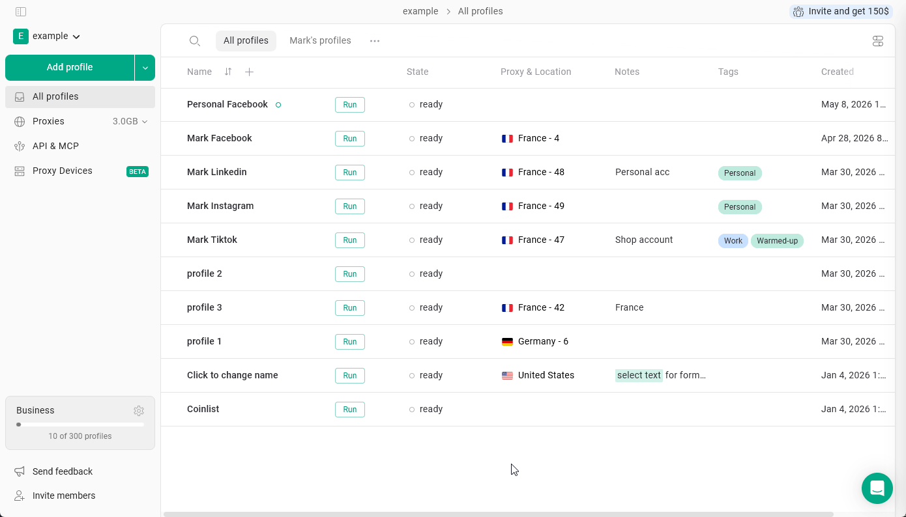
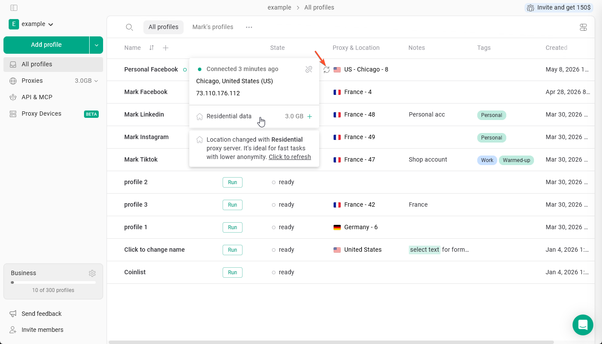
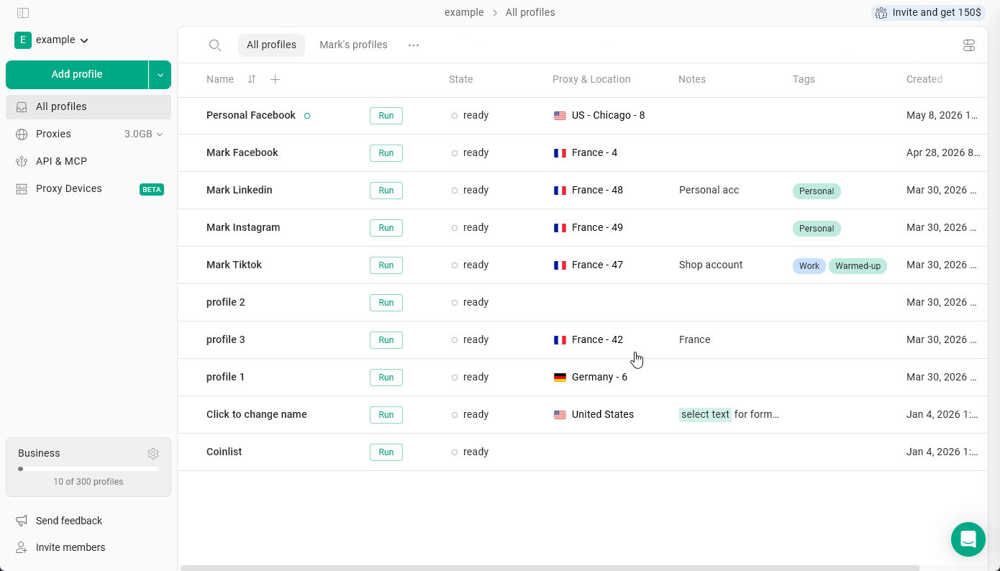
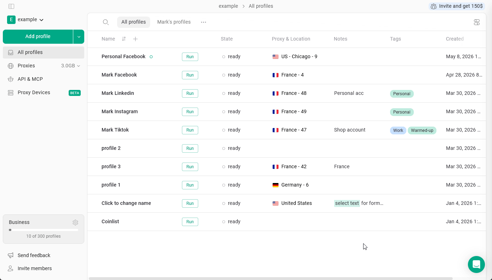

## Dostępne ustawienia proxy

Jeśli chcesz skonfigurować konkretne parametry proxy, musisz **utworzyć nowe połączenie proxy**.

<Info>
  Uwaga: nie można zmienić ustawień istniejącego połączenia proxy.
</Info>

Aby utworzyć nowe niestandardowe proxy Gologin:

1. Kliknij **Choose location or proxy** w profilu przeglądarki.
2. Kliknij **strzałkę** obok wybranego kraju proxy.
3. Wybierz **Add new server**. Możesz tutaj skonfigurować następujące parametry:
   - **City** - dostępne dla niektórych z najpopularniejszych krajów
   - **Name** - własna nazwa połączenia proxy
   - **Proxy type** - rezydencjalne, mobilne lub datacenter
4. Kliknij **Connect**, aby zastosować nowe proxy.

<Frame>
  
</Frame>

## Wybór protokołu proxy (HTTP lub SOCKS5)

Proxy Gologin obsługują HTTP i **SOCKS5**. Protokół możesz wybrać w następujący sposób:

- **Podczas tworzenia profilu:** kliknij **Add profile** > **Proxy** > **Gologin proxy**, wybierz kraj i typ proxy, a następnie wybierz protokół.
- **W istniejącym profilu:** kliknij trzy kropki przy profilu > **Settings** > **Proxy** i wybierz protokół w ten sam sposób.

## Sprawdzanie połączenia i wyświetlanie informacji o proxy

Aby sprawdzić, czy proxy działa prawidłowo i czy masz wystarczającą ilość dostępnego ruchu, kliknij ikonę **okrągłych strzałek** obok flagi proxy. W tym menu możesz także zobaczyć:

- **City**
- **IP address**
- **Proxy type**
- **Remaining traffic**

Dzięki temu szybko potwierdzisz, że proxy jest aktywne i skonfigurowane zgodnie z oczekiwaniami.

<Frame>
  
</Frame>

## Odłączanie proxy

Jeśli chcesz odłączyć proxy Gologin od profilu: **kliknij proxy** jeden raz, a następnie kliknij **X** przy nim. Proxy zostanie odłączone od profilu, ale pozostanie na liście w menedżerze proxy.

<Frame>
  
</Frame>

## Usuwanie proxy

Aby usunąć proxy: **kliknij proxy w profilu** jeden raz, aby przejść do menedżera proxy, a następnie **kliknij je prawym przyciskiem myszy** \> **Delete proxy** \> **potwierdź wybór**. Proxy zostanie usunięte z Twojej listy i będzie można je przywrócić z [archiwum proxy](/pl/proxy/proxy-management/proxy-manager/proxy-archive).

<Frame>
  
</Frame>

## Kopiowanie danych uwierzytelniających proxy

Dane uwierzytelniające proxy Gologin (host, port, login, hasło) możesz skopiować, aby użyć ich w innym miejscu. Aby to zrobić: **kliknij proxy**, aby przejść do menedżera proxy \> **kliknij je prawym przyciskiem myszy** \> **Copy proxy**.

Działa to dla każdego proxy na liście, także dla Twoich własnych. Aby sprawdzić proxy, potrzebujesz jego protokołu, hosta, portu, loginu i hasła.

<Frame>
  
</Frame>

## Operacje zbiorcze na proxy

W menedżerze proxy możesz zaznaczyć wiele proxy naraz i wykonać na nich takie działania, jak:

- zaznaczenie wszystkich proxy
- kopiowanie proxy
- usuwanie proxy

Aby to zrobić: **kliknij dowolne proxy na stronie All profiles** \> **kliknij je prawym przyciskiem myszy** \> kliknij **Select proxy**. Następnie możesz zaznaczać proxy i wykonywać działania za pomocą przycisków u dołu menedżera proxy.

<Frame>
  
</Frame>
