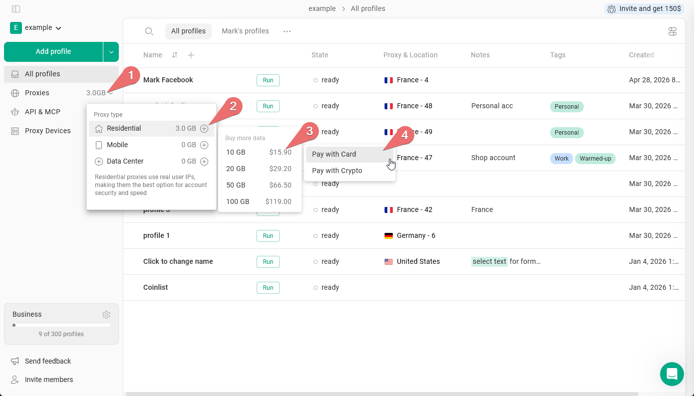
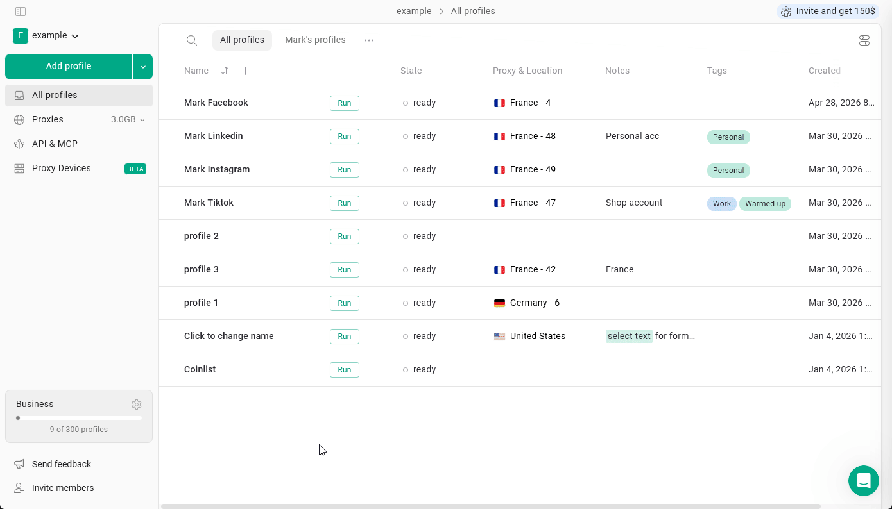
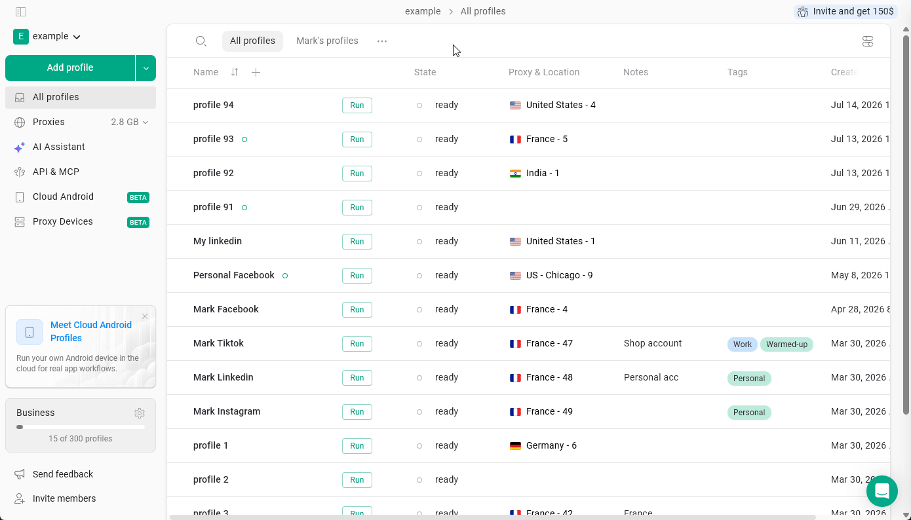
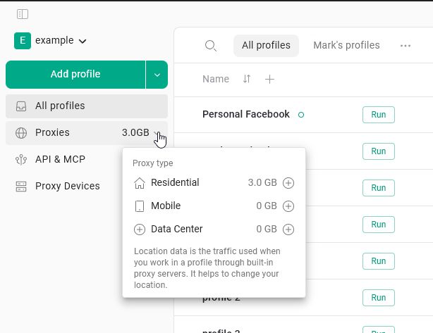

Gologin sprzedaje proxy na dwa sposoby:

- **Transfer proxy** w gigabajtach, wykorzystywany przez nasze proxy rezydencjalne, mobilne i datacenter. Każdy płatny plan już zawiera jego część.
- **Dedicated IP** - jeden statyczny adres IP zarezerwowany wyłącznie dla Ciebie, sprzedawany w ramach subskrypcji za \$5/miesiąc za adres. Ten artykuł opisuje oba rozwiązania.

## Domyślny transfer proxy

Wszystkie płatne plany zawierają **2 GB transferu proxy rezydencjalnych** miesięcznie, niezależnie od poziomu planu i okresu rozliczeniowego (miesięczny lub roczny). Transfer odnawia się na początku każdego miesiąca rozliczeniowego. Niewykorzystany transfer nie przechodzi na kolejny miesiąc - zostaje zastąpiony nowymi 2 GB.

W aplikacji ten limit może być wyświetlany jako **2GB of location data**. Transfer proxy Gologin nie jest wliczony w plan Forever Free.

<Check>
  Subskrybenci planów rocznych również otrzymują 2 GB miesięcznie, a nie 2 GB rocznie. Odnowienie następuje co miesiąc przez cały okres trwania subskrypcji.
</Check>

## Kupowanie dodatkowego transferu

### Jednorazowe doładowanie

Doładowanie to jednorazowy zakup dodatkowego transferu. Skorzystaj z niego, jeśli sporadycznie potrzebujesz więcej transferu i nie potrzebujesz go co miesiąc.

**Kroki:**

1. Na głównej stronie **All profiles** kliknij ilość transferu obok zakładki **Proxies** w menu po lewej stronie.
2. Wybierz **proxy type**, dla którego chcesz kupić transfer.
3. Wybierz **amount of traffic**, której potrzebujesz.
4. Kliknij przycisk **\+** obok wybranej ilości i przejdź do płatności.

<Frame>
  
</Frame>

<Info>
  Ceny wyświetlane w aplikacji są najbardziej aktualne. Sprawdź je bezpośrednio przed zakupem.
</Info>

**Metody płatności za doładowania:**

Możesz zapłacić kartą kredytową lub debetową albo kryptowalutą. Użytkownicy z niektórych krajów - takich jak Rosja i Białoruś - mogą nie mieć możliwości płatności kartą za doładowania. Jeśli płatność kartą zostanie odrzucona, skorzystaj z kryptowaluty.

### Dodatek do subskrypcji

Dodatek do subskrypcji cyklicznie dodaje do Twojego planu określoną ilość transferu proxy. Oznacza to, że transfer jest dodawany automatycznie co miesiąc.

Transfer możesz dodać do subskrypcji podczas pierwszej płatności lub w dowolnym momencie, zmieniając obecny plan.

**Jak dodać transfer do obecnego planu:**

1. Na głównej stronie **All profiles** kliknij **ikonę koła zębatego** obok informacji o planie w lewym dolnym rogu.
2. Kliknij **Change plan**.
3. Na stronie z cennikiem potwierdź swój plan - powinien być widoczny przycisk **Renew the current plan**, co oznacza, że rozszerzasz obecny plan, a nie go zmieniasz.
4. Znajdź dodatek **proxy traffic** i ustaw ilość, która ma być dodawana co miesiąc.
5. Kliknij **Upgrade now**, wybierz metodę płatności i kliknij **Pay now**, aby sfinalizować zakup.

<Frame>
  
</Frame>

**Jak działa cykliczny transfer:**

- **Plan miesięczny** - kwota za dodatek jest pobierana, a transfer dodawany co miesiąc w momencie odnowienia subskrypcji.
- **Plan roczny** - dodatek jest opłacany jednorazowo w ramach rocznej subskrypcji i dodawany do Twojego konta co miesiąc przez cały rok.

Więcej informacji o zmianie planu znajdziesz w artykule [Change and upgrade subscription](/pl/general/account-and-billing/change-plan).

## Zakup Dedicated IP

**Dedicated IP** to pojedynczy statyczny adres, który należy tylko do Ciebie. Nigdy się nie zmienia, nie ma limitu transferu i jest właściwym wyborem dla każdego konta, które musi zachować ten sam adres IP w czasie - Amazon, eBay, LinkedIn, Meta Ads, PayPal, platformy bukmacherskie.

<Info>
  Dedicated IP są dostępne tylko w planach płatnych. Nie są częścią okresu próbnego.
</Info>

### Kroki

1. Kliknij **Add profile**.
2. Otwórz zakładkę **Proxy** i wybierz **Gologin proxy**.
3. Kliknij **Buy dedicated IP**.
4. Wybierz kraj z listy.
5. Kliknij **Buy for \$5/month**.
6. Sfinalizuj płatność w otwartym oknie rozliczeń. Możesz zapłacić kartą przez Stripe lub kryptowalutą przez Cryptomus.
7. Po powrocie do Gologin okno potwierdzenia poinformuje Cię, że płatność przebiegła pomyślnie.
8. Odczekaj **5-7 minut**, aż adres IP zostanie przypisany do Twojego konta.

<Frame>
  
</Frame>

<Note>
  Cena zawsze wynosi **\$5** - Gologin nie dolicza żadnych opłat za przetwarzanie płatności. Jeśli płacisz kryptowalutą, Twój portfel lub giełda mogą naliczyć dodatkową opłatę sieciową poza kwotą faktury. Szczegóły znajdziesz w [Payment methods](https://gologin.com/docs/general/account-and-billing/payment-methods).
</Note>

### Gdzie znaleźć Dedicated IP po zakupie

Adres IP **nie jest automatycznie przypisywany do żadnego profilu**. Po 5-7 minutach odśwież stronę - aby adres się pojawił, może być konieczne ponowne załadowanie strony.

Twój Dedicated IP będzie wtedy dostępny w trzech miejscach:

- Na stronie **Proxies**, na liście Twoich własnych proxy
- W zakładce **Your proxy** na stronie **New Browser Profile**
- W menedżerze proxy na stronie **All profiles**, podczas przypisywania proxy do istniejącego profilu

### Jak działa rozliczanie Dedicated IP

Dedicated IP jest powiązany z Twoją główną subskrypcją Gologin, więc zawsze wygasa wraz z jej zakończeniem.

| Twój plan | Ile płacisz |
| --- | --- |
| Miesięczny | \$5, pobierane od razu, odnawiane co miesiąc razem z planem |
| Roczny, z pozostałymi miesiącami | \$5 × liczba pozostałych miesięcy, pobierane od razu |

Jeśli w Twoim planie rocznym pozostał niepełny miesiąc, jest on rozliczany jako pełny miesiąc.

**Dopóki Twoja subskrypcja jest aktywna i się odnawia, adres IP pozostaje taki sam.** Zachowujesz ten sam adres aż do anulowania.

<Warning>
  Jeśli płacisz kryptowalutą, Dedicated IP nie może odnawiać się automatycznie. Działa przez opłacony okres, a potem przestaje działać, i nie będzie można później odzyskać tego samego adresu IP.
</Warning>

### Anulowanie i zwroty

- Dedicated IP jest anulowany razem z Twoją subskrypcją Gologin. Obecnie nie ma możliwości osobnego anulowania pojedynczego adresu IP.
- Jeśli anulujesz subskrypcję, adres IP działa do końca okresu, który został już opłacony.
- Zwroty są możliwe w ciągu **14 dni** od zakupu - skontaktuj się z pomocą techniczną.

<Note>
  Dedicated IP należy do konta, które go kupiło, i nie jest udostępniany innym członkom workspace. Jeśli jednak przypiszesz go do profilu i udostępnisz ten profil, każdy, kto ma dostęp do profilu, będzie mógł z niego korzystać.
</Note>

## Sprawdzanie dostępnego transferu proxy Gologin

Aby sprawdzić, ile transferu zostało, wystarczy najechać kursorem na aktualnie dostępny transfer w menu po lewej stronie. Zobaczysz zestawienie pozostałego transferu dla każdego typu proxy.

<Frame>
  
</Frame>
