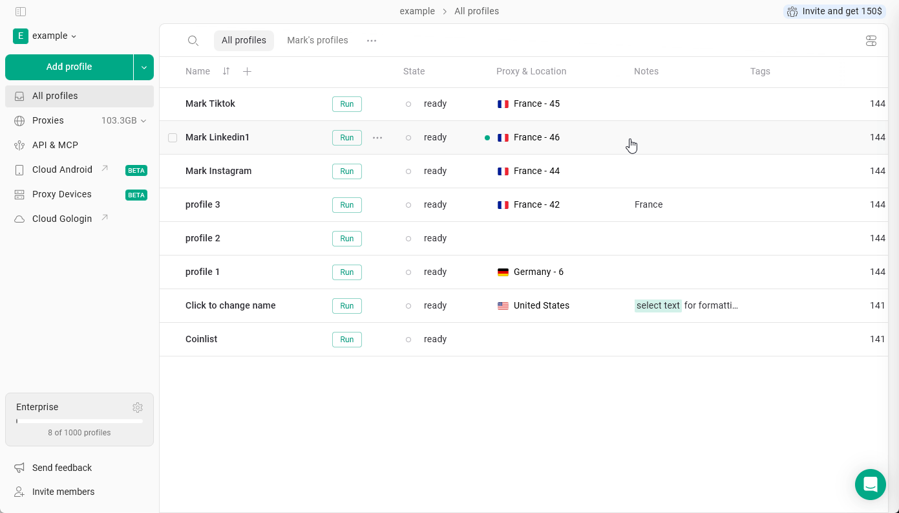
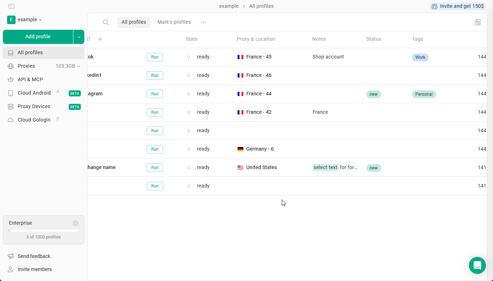
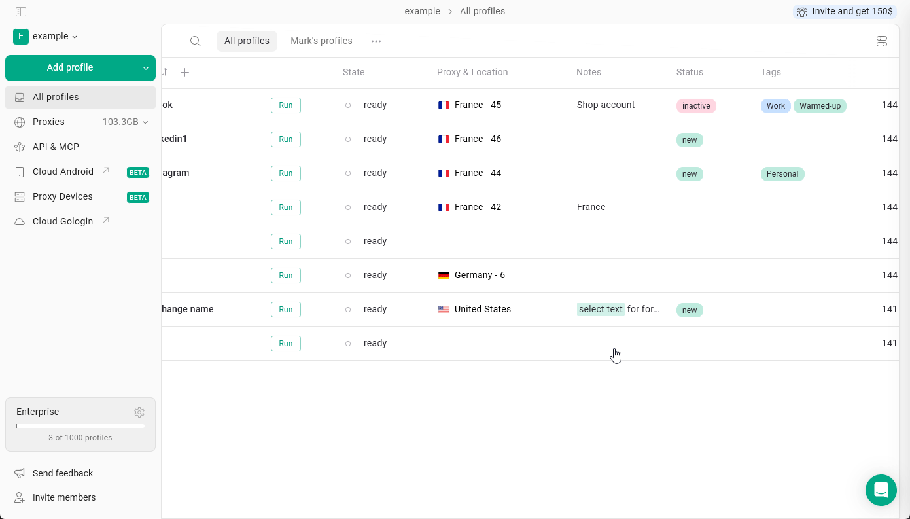
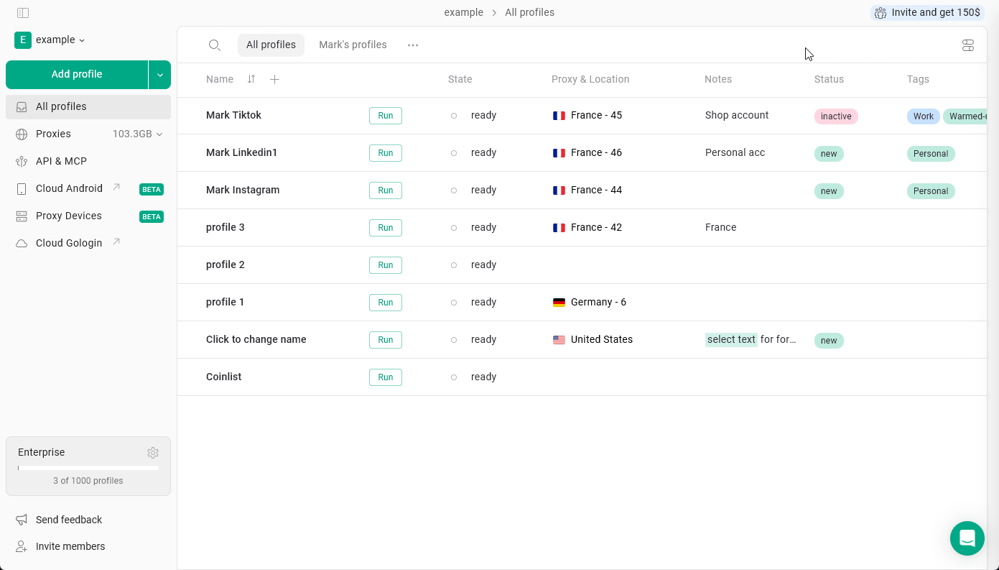

Esses campos de texto do perfil ajudam os usuários a diferenciar, filtrar e encontrar perfis com facilidade.

## Notas

As **Notas** no Gologin permitem armazenar informações adicionais diretamente em cada perfil de navegador. Isso é útil para acompanhar detalhes de contas, lembretes ou qualquer contexto relacionado a um perfil específico.

Para **adicionar uma nota ao perfil**, basta clicar nas notas do perfil e começar a digitar.

<Frame>
  
</Frame>

As notas aceitam **formatação** básica, incluindo **negrito**, _itálico_, ~~tachado~~, cor de fundo e <u>sublinhado</u>.  Selecione o texto e aplique!

## Etiquetas e Estado

As **Etiquetas** permitem rotular perfis com palavras-chave para ajudar a categorizá-los e filtrá-los por tipo de conta, plataforma ou projeto, enquanto o **Estado** exibe a situação do fluxo de trabalho.

<Info>
  Esses campos ficam ocultos por padrão. Acesse [esta página](/pt/browser-profiles/profile-management/add-more-info-columns) para saber como ativá-los nas configurações.
</Info>

<Tip>
  A principal diferença é que um perfil pode ter várias etiquetas, mas apenas um estado.
</Tip>

### Criar ou adicionar

Para **criar uma nova etiqueta ou um novo estado**, clique no respectivo campo no perfil e comece a digitar. Você também pode escolher **uma cor** ao criar ou editar: selecione uma das cores predefinidas ou defina **a sua própria** com o seletor de cores ou um código HEX.

Você pode **atribuir etiquetas existentes** a um perfil selecionando-as na lista.

<Frame>
  
</Frame>

### Filtrar por

Você pode filtrar perfis por estado ou etiquetas. Para isso, clique no campo correspondente e selecione a etiqueta ou o estado que deseja usar como filtro.

Para limpar o filtro, clique na seta ao lado da categoria do campo.

<Frame>
  
</Frame>

### Modificar etiquetas e estado

- Para **remover** uma etiqueta ou um estado de um perfil: Clique no campo → clique no **X** ao lado do item
- Para **excluir** uma etiqueta ou um estado por completo: Clique no campo → clique nos **três pontos** ao lado do item na lista → **Excluir**

Você também pode alterar as cores das etiquetas e dos estados a partir dessa lista.

<Frame>
  
</Frame>

## Trabalho em equipe

Esses campos se comportam de maneira diferente ao trabalhar com perfis, pastas e espaços de trabalho compartilhados.

- **As notas são totalmente sincronizadas**. Qualquer alteração feita nas notas ficará visível para todos os membros da equipe.
- **Etiquetas e Estado são específicos de cada usuário**. Ao compartilhar um perfil, os destinatários não verão suas etiquetas nem seu estado e poderão atribuir os próprios, de acordo com o fluxo de trabalho deles.

<Info>
  Os membros da equipe precisam de acesso "pode editar" para alterar as notas, o estado e as etiquetas do perfil
</Info>
