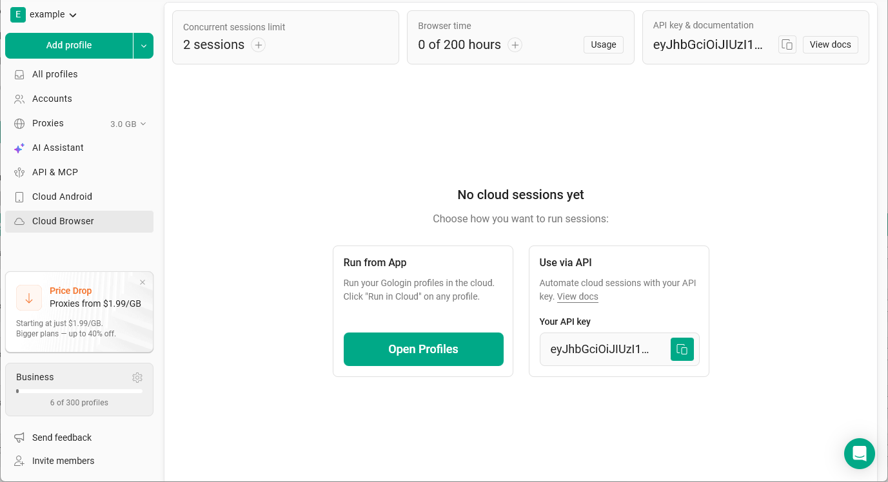
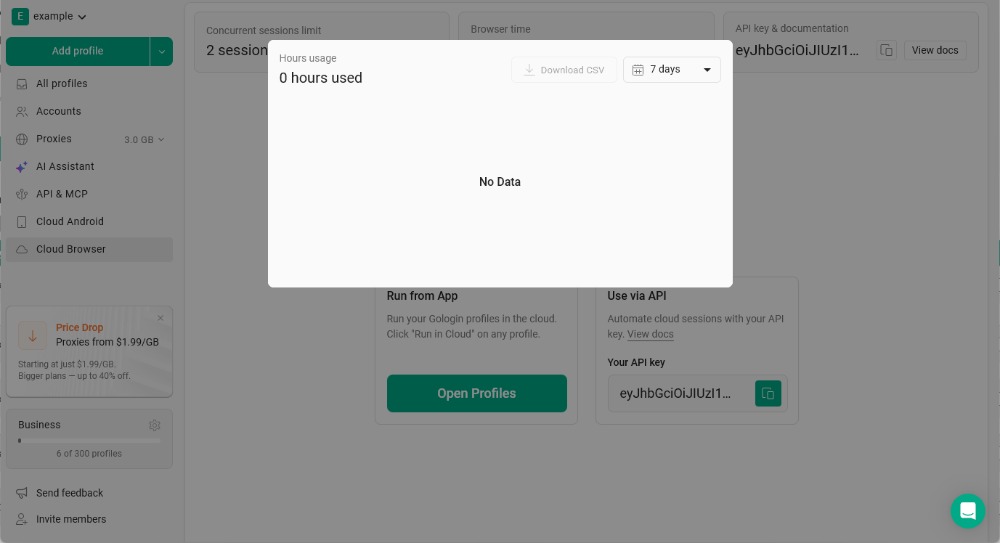
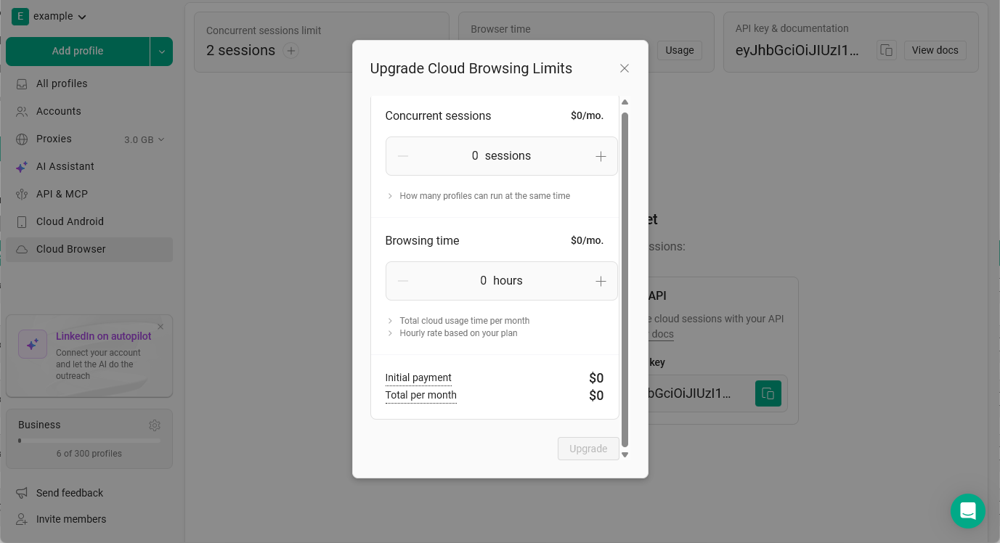

O painel **Cloud Browser** mostra seus limites e seu uso do navegador na nuvem (para perfis iniciados com **Run in Cloud**, no aplicativo web ou pela API do Cloud Browser) e permite comprar mais limites de nuvem.

Para abri-lo, clique em **Cloud Browser** no menu à esquerda.

## O que você encontra nele

No topo da página:

- **Concurrent sessions limit** - quantos perfis na nuvem podem ser executados ao mesmo tempo. Clique em **\+** para comprar mais sessões.
- **Browser time** - horas de nuvem usadas neste mês em relação ao seu limite mensal, por exemplo **0 of 200 hours**. Clique em **\+** para comprar mais horas ou em **Usage** para ver as estatísticas.
- **API key & documentation** - o token da API do Cloud Browser. Clique no ícone de cópia para copiá-lo ou em **View docs** para abrir a documentação da API.

Se você ainda não executou nenhum perfil na nuvem, a página mostra duas formas de começar:

- **Run from App** - clique em **Open Profiles** e depois em **Run in Cloud** em qualquer perfil.
- **Use via API** - copie **Your API key** e clique em **View docs** para ver como usá-la.

### Estatísticas de uso

Clique em **Usage** no bloco **Browser time** para ver quantas horas de nuvem você usou. Escolha o período no canto superior direito, por exemplo **7 days**, e clique em **Download CSV** para baixar os dados.

## Comprando mais limites de nuvem

Clique em **\+** ao lado de **Concurrent sessions limit** ou **Browser time**. Na janela **Upgrade Cloud Browsing Limits**, escolha o que você precisa:

- **Concurrent sessions** - **\$2 por sessão por mês**. Define quantos perfis podem ser executados na nuvem ao mesmo tempo.
- **Browsing time** - horas de nuvem extras por mês. O valor por hora depende do seu plano: **\$0.09** no Professional, **\$0.08** no Business, **\$0.07** no Enterprise e **\$0.05** nos planos Custom.

A janela mostra quanto você paga agora (**Initial payment**) e quanto por mês (**Total per month**). Clique em **Upgrade** para pagar. Os limites de nuvem adicionais só podem ser pagos pelo **Stripe**. PayPal e criptomoedas não estão disponíveis para eles.

### Como funciona a cobrança dos limites extras

O preço dos limites extras é o mesmo para planos mensais e anuais, mas a cobrança funciona de forma diferente:

- **Plano mensal** - você paga pelos limites extras somente até o fim do período de cobrança atual. Depois disso, eles são renovados junto com o seu plano.
- **Plano anual** - você paga um mês por vez. Os limites extras são cobrados separadamente todos os meses até o fim do seu plano anual.

<Note>
  Os perfis de navegador na nuvem e os limites extras de nuvem estão disponíveis somente em planos pagos.
</Note>
