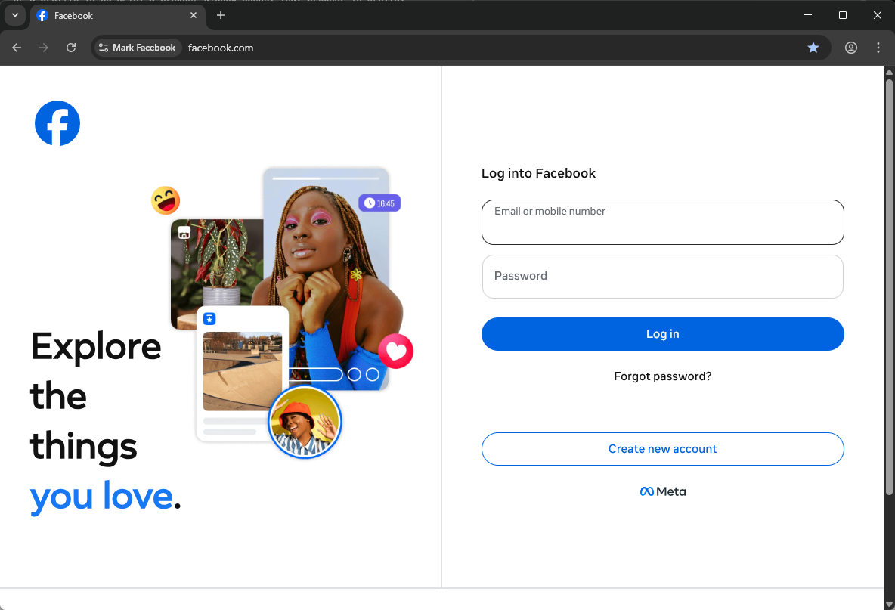

Quando você clica em **Executar** em um perfil no Gologin, uma janela do navegador é aberta. Esse navegador é o **Orbita**.

Ele é idêntico ao Google Chrome: mesmo layout, mesmas abas, mesmos menus. A diferença está no que acontece nos bastidores quando um site tenta identificar você.

<Frame>
  
</Frame>

## Por que criamos nosso próprio navegador

Todo navegador tem um problema de identidade. Quando você acessa um site, ele pode fazer ao seu navegador, de forma discreta, dezenas de perguntas sobre o dispositivo em que ele está rodando: qual GPU você tem, quais fontes estão instaladas, qual é a resolução da sua tela, como o navegador renderiza gráficos e muito mais. As respostas a essas perguntas formam uma impressão digital que identifica você, mesmo que você use uma VPN ou limpe seus cookies.

O Chrome padrão não tenta esconder nada disso. Ele responde a todas as perguntas com sinceridade, usando os dados reais do seu dispositivo.

## O que o Orbita realmente muda

Quando um site pede ao Orbita informações sobre o dispositivo em que ele está rodando, o Orbita retorna os valores do perfil, e não os valores reais do seu computador. Isso inclui itens como:

- A versão do navegador e o sistema operacional informados aos sites
- Tamanho e resolução da tela
- Detalhes da placa de vídeo
- A lista de fontes disponíveis no dispositivo
- Como o navegador renderiza gráficos e áudio (usado para fingerprinting)
- Seu fuso horário e idioma
- A exposição do seu IP por meio de recursos de vídeo e áudio (WebRTC)
- E mais alguns detalhes internos

Do ponto de vista do site, ele está se comunicando com o dispositivo que o perfil foi configurado para ser, e não com o seu computador real.

## Cada perfil é totalmente isolado

Quando você abre dois perfis, cada um é executado em um ambiente completamente separado. Cookies, logins salvos, histórico de navegação e dados de sessão de um não têm relação nenhuma com os do outro. Ao fechar um perfil, tudo o que há nele é salvo, e na próxima vez ele continua exatamente de onde parou.

Esse isolamento é o que torna o Gologin útil para gerenciar várias contas. As contas não compartilham nenhuma informação no nível do navegador.

## A experiência de uso é diferente?

Não. O Orbita é construído sobre a mesma base de código aberto do Chrome, então a experiência é idêntica à de usar o Chrome. Favoritos, extensões, atalhos de teclado, ferramentas do desenvolvedor: tudo igual. As alterações feitas pelo Orbita são invisíveis para quem está navegando.

## Versões do navegador

Os perfis do Gologin são executados apenas no Orbita, que é baseado no Chromium. Perfis baseados em Firefox não estão disponíveis, e não é possível converter um perfil para outro navegador.

Você escolhe a versão do Orbita somente ao criar um novo perfil: **Adicionar perfil** > **Avançado** > **versão orbita**. Depois que o perfil é criado, não é possível trocar a versão por outra; só é possível atualizá-lo para a versão mais recente: clique nos três pontos ao lado do perfil > **Atualizar o browser**. Se você não encontrar a opção **Atualizar o browser**, o perfil já está na versão mais recente.

## Mantendo o Orbita atualizado

O Orbita acompanha os lançamentos de versões do Chrome. Isso é importante porque um navegador que informa uma versão desatualizada parece suspeito para os sites. O Gologin atualiza o Orbita regularmente, e você pode [atualizar perfis individuais](/pt/updating-your-browser-profile) para a versão mais recente do navegador pelo menu do perfil.

<Tip>
  Se você tem perfis mais antigos, vale a pena verificar se eles estão usando a versão mais recente do Orbita. Você pode fazer isso pelo menu de três pontos ao lado de qualquer perfil.
</Tip>

## Orbita no Android

O Gologin também tem um aplicativo para Android que usa o Orbita como mecanismo do navegador. No celular, o Orbita é executado nativamente no dispositivo, o que significa que os dados de sensores que os sites conseguem detectar (movimento, bateria, tipo de tela) vêm do hardware real do aparelho, e não de uma simulação. Isso torna os perfis mobile mais difíceis de distinguir de um usuário móvel genuíno.
