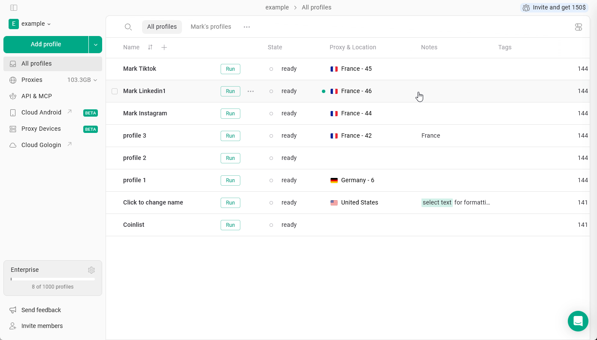
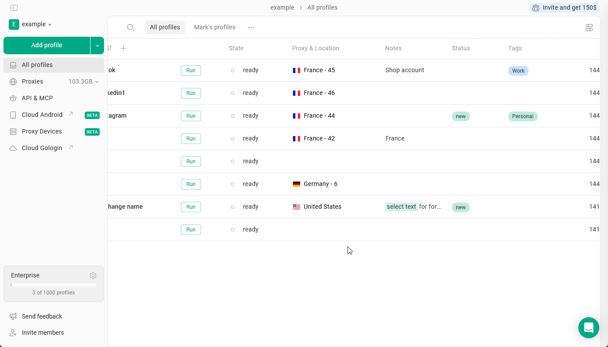
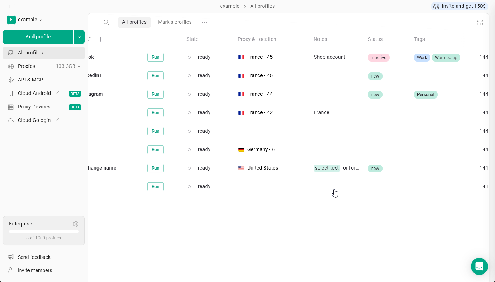
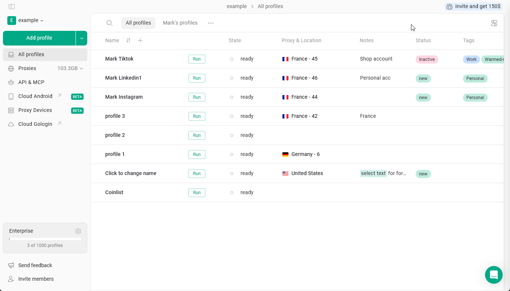

Эти текстовые поля профилей помогают легко различать, фильтровать и находить профили.

## Заметки

**Заметки** в Gologin позволяют хранить дополнительную информацию прямо в каждом профиле браузера. Это удобно для записи данных об аккаунте, напоминаний и любого контекста, связанного с конкретным профилем.

Чтобы **добавить заметку к профилю**, просто нажмите на заметки профиля и начните вводить текст.

<Frame>
  
</Frame>

Заметки поддерживают базовое **форматирование**: **жирный**, _курсив_, ~~зачеркнутый~~, цвет фона, <u>подчеркнутый</u>.  Выделите текст и примените нужный стиль!

## Теги и статус

**Теги** позволяют помечать профили ключевыми словами, чтобы группировать и фильтровать их по типу аккаунта, платформе или проекту, а **Статус** показывает текущий этап рабочего процесса.

<Info>
  По умолчанию эти поля скрыты. Перейдите на [эту страницу](/ru/browser-profiles/profile-management/add-more-info-columns), чтобы узнать, как включить их в настройках.
</Info>

<Tip>
  Главное отличие: у профиля может быть несколько тегов, но только один статус.
</Tip>

### Создание и добавление

Чтобы **создать новый тег или статус**, нажмите на соответствующее поле в профиле и начните вводить название. При создании или редактировании можно также выбрать **цвет**: используйте один из готовых цветов или задайте **свой** с помощью палитры или HEX-кода.

Вы можете **назначить существующие теги** профилю, выбрав их из списка.

<Frame>
  
</Frame>

### Фильтрация

Профили можно фильтровать по статусу или тегам. Для этого нажмите на нужное поле и выберите тег или статус, по которому хотите отфильтровать.

Чтобы сбросить фильтр, нажмите на стрелку рядом с названием категории поля.

<Frame>
  
</Frame>

### Изменение тегов и статуса

- Чтобы **удалить** тег или статус из профиля: нажмите на поле → нажмите **X** рядом с нужным элементом
- Чтобы **полностью удалить** тег или статус: нажмите на поле → нажмите **три точки** рядом с элементом в списке → **Удалить**

В этом списке также можно изменить цвета тегов и статусов.

<Frame>
  
</Frame>

## Командная работа

Эти поля работают по-разному при использовании общих профилей, папок и рабочих пространств.

- **Заметки полностью синхронизируются**. Любые изменения в заметках видны всем участникам команды.
- **Теги и статус индивидуальны для каждого пользователя**. Когда вы делитесь профилем, получатели не видят ваши теги и статус и могут назначить свои в соответствии со своим рабочим процессом.

<Info>
  Чтобы изменять заметки, статус и теги профиля, участникам команды нужен доступ «может редактировать»
</Info>
