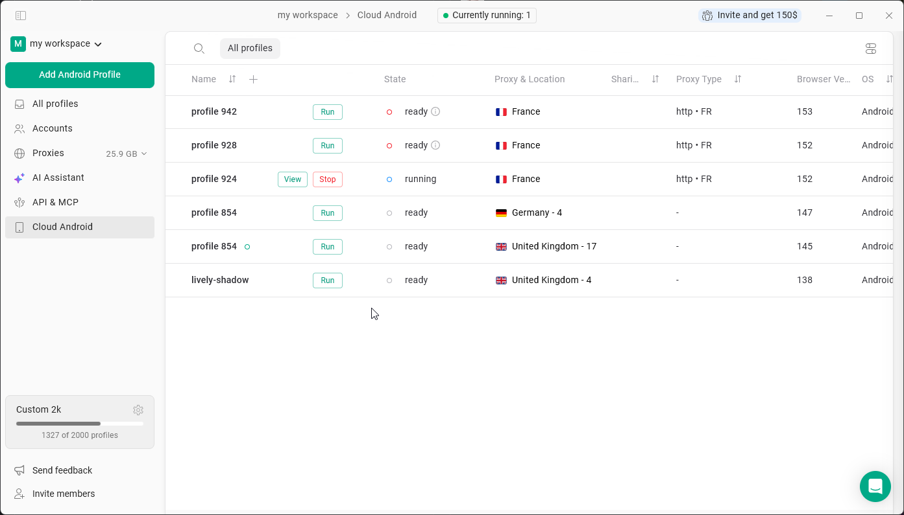
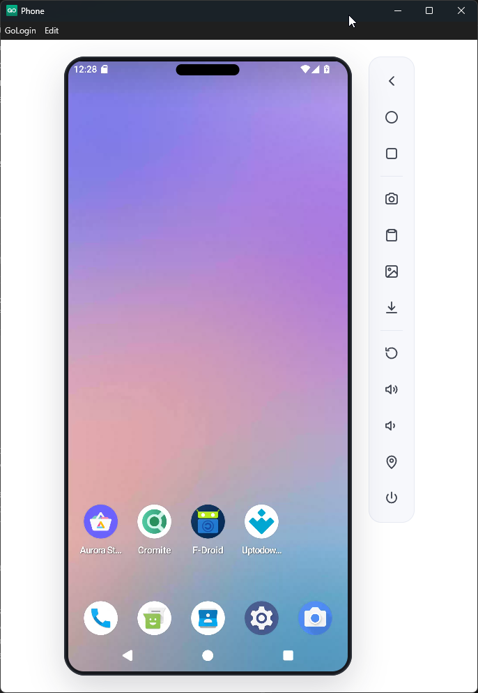

**Cloud Android** позволяет запускать настоящие телефоны Android в облаке прямо из приложения Gologin — физический телефон не нужен. Каждый профиль Cloud Android — это отдельный телефон со своими приложениями и данными, поэтому с мобильными приложениями (например, Instagram) можно работать так же, как с профилями браузера.

## Кто может пользоваться

Cloud Android бесплатен на всех платных тарифах Gologin. Пользователи бесплатного пробного периода тоже могут им пользоваться в течение пробного периода, если зарегистрировались через Google.

| | Одновременно запущенных телефонов | Ограничение по времени |
| --- | --- | --- |
| Пробный период (регистрация через Google) | 1 | Без ограничений |
| Платные тарифы | до 10 | Без ограничений |

## Создание и запуск профиля Cloud Android

1. Нажмите **Cloud Android** в меню слева.
2. Нажмите **Добавить профиль Android**.
3. Настройте прокси и другие параметры.
3. Нажмите **Старт** в профиле. Запуск телефона может занять **до 2 минут**.
4. Когда профиль **запущен**, нажмите **Открыть**, чтобы открыть окно телефона.
5. Чтобы завершить работу, нажмите **Стоп**.

Количество телефонов, запущенных в данный момент, отображается в верхней части страницы (**Сейчас запущено**).

## Работа с телефоном

В окне телефона есть стандартные кнопки Android, а справа — дополнительные инструменты: например, скриншоты, загрузка и скачивание файлов, поворот экрана, громкость, геолокация и питание.

Устанавливайте приложения через магазины приложений на телефоне, такие как **Aurora Store**, **F-Droid** или **Uptodown**. Приложения, логины и другие данные сохраняются в профиле между запусками.

<Note>
  Не все приложения Android работают в Cloud Android. Если приложение не открывается, попробуйте вместо него открыть сайт в браузере.
</Note>

## Прокси

Телефоны Cloud Android работают на серверах Gologin, поэтому без прокси сайты и приложения видят IP-адрес сервера, а не ваш. Добавьте прокси в профиль так же, как и в профили браузера: поддерживаются все типы прокси, включая прокси Gologin и ваши собственные. Мобильные прокси выглядят для телефона наиболее естественно, но подойдёт любой тип.

## Тайм-аут неактивности

Если в запущенном телефоне нет активности в течение **15 минут**, он автоматически останавливается. Ваши данные сохраняются.

## См. также

- [FAQ: Cloud Android](/ru/cloud-android/faq)
- [Добавление прокси и управление ими](/ru/proxy/proxy-management/adding-proxies)
