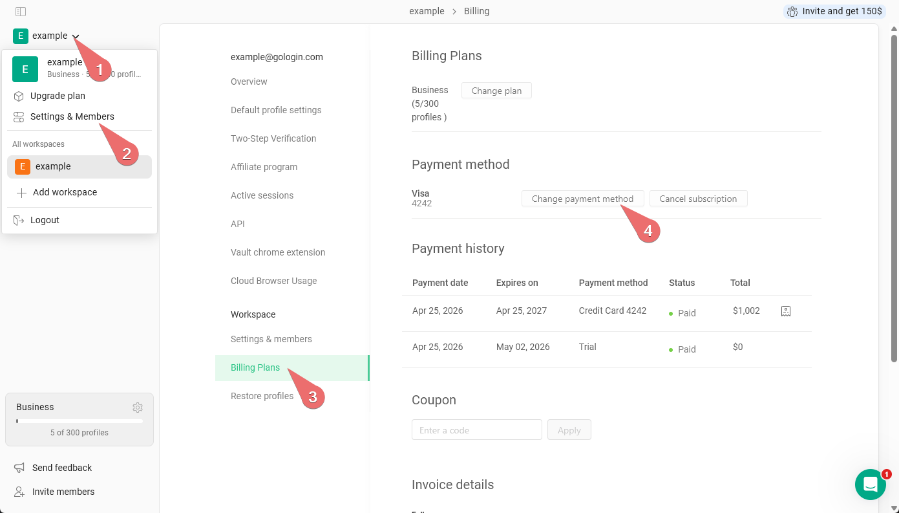
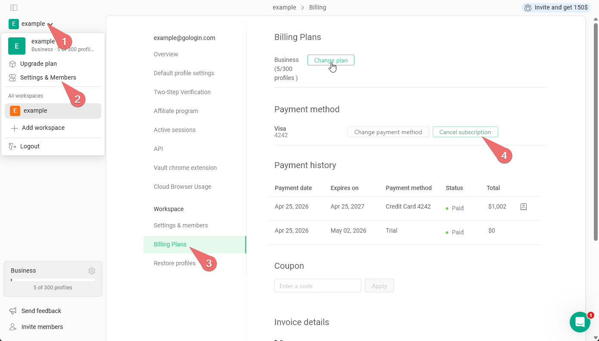

## Thay đổi phương thức thanh toán

Hiện tại, bạn không thể thay đổi phương thức thanh toán nếu không thực hiện một khoản thanh toán. Dưới đây là những gì bạn có thể làm:

### Thay đổi phương thức thanh toán bằng cách mua gói

1. Vào **menu chính ở góc trên bên trái \>** **Cài đặt & thành viên \> Kế hoạch thanh toán \> Phương thức thanh toán \> Thay đổi phương thức thanh toán.**
   <Frame>
     
   </Frame>
2. Gia hạn gói hiện tại hoặc nâng cấp gói. Phương thức thanh toán sẽ được cập nhật.
   1. gói hiện tại của bạn sẽ được tính khi [nâng cấp gói](/vi/general/account-and-billing/change-plan)

### Thay đổi phương thức thanh toán bằng cách xóa phương thức hiện tại

1. Xóa phương thức thanh toán hiện tại trong **menu chính ở góc trên bên trái \>** **Cài đặt & thành viên \> Kế hoạch thanh toán \> Phương thức thanh toán \> Hủy đăng ký.**
   <Frame>
     
   </Frame>
2. Chờ gói hiện tại hết hạn, sau đó mua gói mới bằng thẻ mới hoặc PayPal.

## Hủy đăng ký

Nếu muốn hủy đăng ký hiện tại, bạn chỉ cần xóa phương thức thanh toán khỏi tài khoản. Vào **menu chính ở góc trên bên trái \>** **Cài đặt & thành viên \> Kế hoạch thanh toán \> Phương thức thanh toán \> Hủy đăng ký.**

## Các phương thức thanh toán khả dụng

Gologin hỗ trợ nhiều phương thức thanh toán cho đăng ký gói và nạp lưu lượng proxy.

### Đăng ký gói

Thanh toán đăng ký có thể bao gồm các tiện ích bổ sung cho thành viên nhóm và lưu lượng proxy. Có hai loại thanh toán đăng ký: **định kỳ** và **một lần**.

**Thanh toán định kỳ** được tự động trừ tiền trước khi mỗi chu kỳ thanh toán mới bắt đầu. Các phương thức sau hỗ trợ thanh toán định kỳ:

- **Stripe** - thẻ tín dụng và thẻ ghi nợ, Google Pay, Apple Pay
- **PayPal** - thanh toán từ số dư PayPal hoặc qua thẻ đã liên kết

**Thanh toán một lần** chỉ bị trừ tiền một lần tại thời điểm mua và không tự động gia hạn. Các phương thức sau hỗ trợ thanh toán một lần:

- **Stripe** - WeChat Pay, Pix, Cash App, Amazon Pay, tài khoản ngân hàng Hoa Kỳ hoặc SEPA
- **Cryptomus** - thanh toán bằng tiền điện tử

Thanh toán một lần, bao gồm cả tiền điện tử, không tự động gia hạn - bạn không cần hủy gì cả.

### Giới hạn Cloud Browser

Các giới hạn Cloud Browser bổ sung chỉ có thể thanh toán bằng thẻ hoặc PayPal. Không hỗ trợ thanh toán bằng tiền điện tử cho các giới hạn này.

### Nạp lưu lượng proxy

- **Paddle** - chỉ thẻ tín dụng và thẻ ghi nợ
- **Cryptomus** - thanh toán bằng tiền điện tử

## Thông tin thêm về các phương thức thanh toán

### Thanh toán bằng tiền điện tử

Thanh toán bằng tiền điện tử được xử lý qua Cryptomus. Trên trang thanh toán, hãy chọn đồng coin và mạng lưới bạn sẽ dùng để thanh toán: các tùy chọn khả dụng được liệt kê tại đó.

<Warning>
  Hãy gửi đúng đồng coin bạn đã chọn trên đúng mạng lưới hiển thị trên trang thanh toán, đến đúng địa chỉ được hiển thị tại đó. Khoản thanh toán gửi qua mạng lưới khác **sẽ không đến nơi và không thể khôi phục**. Luôn kiểm tra kỹ mạng lưới trước khi xác nhận giao dịch.
</Warning>

<Note>
  Cryptomus, đơn vị cung cấp dịch vụ thanh toán bằng tiền điện tử của chúng tôi, có thể không hoạt động ở một số quốc gia. Hiện tại đơn vị này không cung cấp dịch vụ cho người dùng từ Canada. Nếu trang thanh toán bằng tiền điện tử không mở được, hãy dùng phương thức thanh toán khác.
</Note>

Sau khi gửi khoản thanh toán bằng tiền điện tử, hãy chờ một thời gian để giao dịch được xác nhận trên blockchain. Nếu gói đăng ký của bạn chưa được cập nhật sau khi giao dịch đã được xác nhận, hãy khởi động lại ứng dụng Gologin và chờ tối đa 24 giờ. Nếu sự cố vẫn tiếp diễn, hãy liên hệ bộ phận hỗ trợ và cung cấp mã băm giao dịch (transaction hash) của bạn.

### Phí mạng lưới cho thanh toán bằng tiền điện tử

Khi thanh toán bằng tiền điện tử, bạn có thể thấy ghi chú "You pay network fee" trên màn hình thanh toán. Điều này đơn giản có nghĩa là bạn chi trả phí mạng lưới blockchain (còn gọi là phí gas) cho giao dịch của mình.

Gologin và Cryptomus (đơn vị cung cấp dịch vụ thanh toán của chúng tôi) không tính thêm bất kỳ khoản phí nào vào khoản thanh toán của bạn. Phí mạng lưới không phải của chúng tôi - khoản phí này do chính blockchain thu và được thanh toán qua ví hoặc sàn giao dịch mà bạn dùng để gửi tiền. Số tiền chính xác phụ thuộc vào đồng coin và mạng lưới bạn chọn, cũng như mức độ tắc nghẽn của mạng lưới tại thời điểm đó.

Chúng tôi khuyến nghị sử dụng mạng TRON (TRC-20) để thanh toán, vì đây là lựa chọn rẻ nhất và nhanh nhất.

<Info>
  Nếu bạn gửi từ sàn giao dịch thay vì ví cá nhân, sàn có thể tính thêm phí rút tiền riêng ngoài phí mạng lưới. Hãy kiểm tra tổng số tiền trước khi xác nhận.
</Info>

<Warning>
  Một số ví và sàn giao dịch trừ phí mạng lưới khỏi số tiền bạn nhập, nên số tiền thực tế nhận được sẽ ít hơn hóa đơn. Nếu số tiền nhận được thấp hơn số tiền yêu cầu, khoản thanh toán của bạn có thể không được ghi nhận tự động.

  Để tránh điều này, hãy cộng thêm phí và gửi nhiều hơn một chút so với số tiền trên hóa đơn. Nếu bạn đã thanh toán thiếu, tiền của bạn không bị mất - hãy liên hệ bộ phận hỗ trợ để khoản thanh toán được áp dụng thủ công.
</Warning>

### Phương thức thanh toán theo khu vực

Một số phương thức thanh toán chỉ khả dụng ở những quốc gia nhất định. Ví dụ:

- **WeChat Pay** khả dụng cho người dùng ở Trung Quốc
- **Pix** khả dụng cho người dùng ở Brazil
- Yookassa khả dụng cho người dùng ở Nga

Để thấy các tùy chọn này trên trang thanh toán, hãy đảm bảo bạn đang kết nối bằng địa chỉ IP của quốc gia tương ứng - nếu không, tùy chọn sẽ không hiển thị.

### Thanh toán bằng tài khoản ngân hàng Hoa Kỳ và SEPA

Gologin chấp nhận thanh toán bằng tài khoản ngân hàng Hoa Kỳ và SEPA thông qua Stripe. Phương thức này hoạt động khác với thẻ - khoản thanh toán không được xử lý ngay lập tức.

Sau khi hoàn tất thanh toán, bạn cần chờ **từ 3–5 ngày làm việc** để khoản tiền được ghi có vào tài khoản của bạn. Gói đăng ký hoặc gói dịch vụ Gologin của bạn sẽ không được kích hoạt cho đến khi tiền được xác nhận.

Hãy lưu ý điều này nếu bạn đang gấp thời hạn - để được truy cập ngay lập tức, hãy dùng thẻ hoặc một phương thức thanh toán tức thời khác.

### Sự cố với thẻ doanh nghiệp

Một số thẻ tín dụng doanh nghiệp hoặc thẻ công ty có thể bị đơn vị xử lý thanh toán của chúng tôi từ chối. Nếu thẻ doanh nghiệp của bạn không được chấp nhận:

- Hãy thử dùng **thẻ tín dụng hoặc thẻ ghi nợ cá nhân**
- Dùng **PayPal** làm phương thức thanh toán thay thế
- Thanh toán bằng **tiền điện tử** (xem phần trên)
