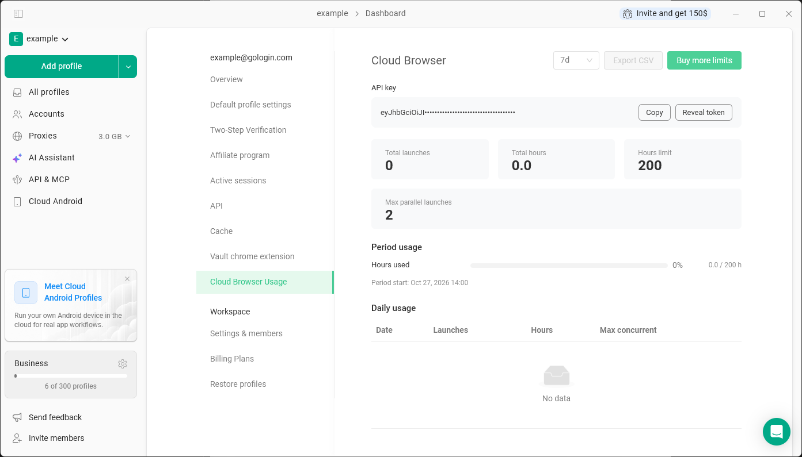
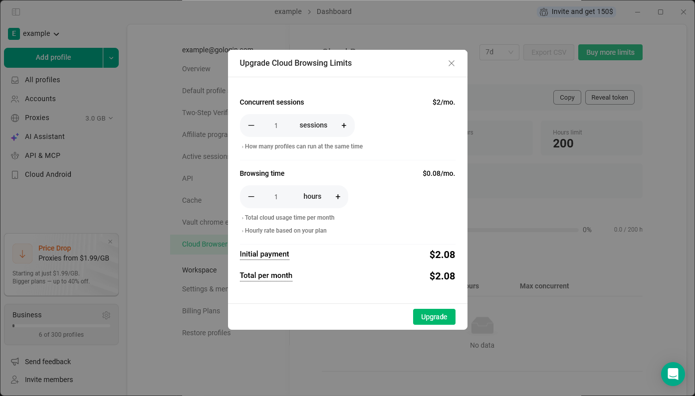

**Cloud Browser 使用情况**页面显示您如何使用云端浏览器配置文件（即使用**在云端运行**、在网页应用中或通过 Cloud Browser API 启动的配置文件），并且您可以在此购买更多云端限额。

打开方式：点击左上角的**工作区名称** > **设置和成员** > **Cloud Browser 使用情况**。

## 页面内容

- **API 密钥** - Cloud Browser API 的令牌。点击**显示令牌**查看，或点击**复制**进行复制。
- 所选期间的**发射总数**和**总时数**
- **小时限制** - 您的套餐每月可用的云端小时数
- **最大并行发射次数** - 可同时运行的云端配置文件数量
- **期间使用** - 当前期间已使用的小时数以及该期间的开始时间
- **日常使用** - 每天的启动次数、小时数以及并发会话的最大数量。使用**导出 CSV** 可下载这些数据。

## 购买更多云端限额

点击**购买更多限额**，然后选择您需要的内容：

- **并发会话** - **每个会话每月 \$2**。设置可同时在云端运行的配置文件数量。
- **浏览时间** - 每月额外的云端小时数。每小时费率取决于您的套餐：Professional 套餐为 **\$0.09**，Business 套餐为 **\$0.08**，Enterprise 套餐为 **\$0.07**，Custom 套餐为 **\$0.05**。

点击**升级**进行支付。额外的云端限额只能通过 Stripe 支付，不支持加密货币和 PayPal。

### 额外限额的计费方式

额外限额的价格对月付和年付套餐是相同的，但收费方式不同：

- **月付套餐** - 您只需为额外限额支付至当前计费周期结束。之后，它们会随您的套餐一起续订。
- **年付套餐** - 您按月付款。额外限额将每月单独收费，直至您的年付套餐结束。

<Note>
  云端浏览器配置文件和额外的云端限额仅适用于付费套餐。
</Note>
