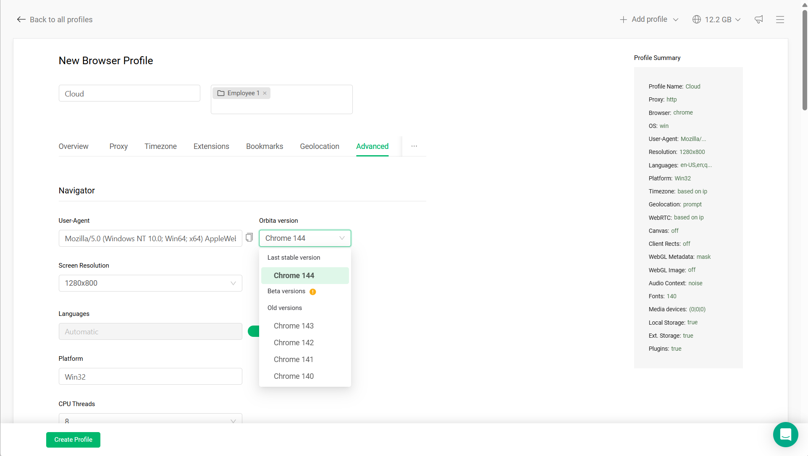

在 Gologin 中，每个浏览器配置文件都绑定了特定的浏览器版本和指纹配置。

更新浏览器版本有助于让您的配置文件与现代网站保持兼容，同时保持一致的环境。

## 为什么要更新配置文件

网站会定期更新其要求，可能需要更新版本的浏览器。

如果您发现以下情况，可能需要更新配置文件：

- 网站无法加载或显示异常
- 登录或会话出现问题
- 功能无法正常使用
- 出现浏览器版本过旧的警告

更新可以让您的配置文件与真实用户的环境保持一致。

## 何时更新

您不需要定期更新配置文件。

仅在以下情况下更新：

- 某些功能不再正常工作
- 某个平台要求使用更新版本的浏览器
- 您正在创建新的配置文件

如果配置文件稳定且运行正常，最好保持不变。

## 如何更新配置文件

要将现有配置文件更新到最新的 Orbita 版本：

1. 点击配置文件上**运行**旁边的**三个点**
2. 选择**更新浏览器**
3. 启动配置文件并进行测试

如果您没有看到**更新浏览器**，说明该配置文件已在使用最新的 Orbita 版本。

## 为新配置文件选择版本

只有在创建新配置文件时，才能选择特定的 Orbita 版本：点击**添加简介**，打开**先进的**选项卡，然后在**轨道版**下选择版本。配置文件创建后，就无法切换到其他版本，只能按上述方法更新到最新版本。

<Frame>
  
</Frame>

## 安全更新与有风险的更新

**安全的更新：**

- 仅更新浏览器版本
- 版本跨度较小的更新
- 在正式使用之前更新

**有风险的操作：**

- 同时更改多项设置
- 在更新的同时更改代理或位置
- 在未经测试的情况下更新使用频繁或敏感的配置文件（广告、加密货币）

## 最佳实践

- 保持活跃的配置文件稳定
- 仅在必要时更新
- 更新后进行测试
- 除非必要，避免使用测试版

## 关键要点

更新浏览器版本可以提高兼容性，但稳定性更为重要。

在 Gologin 中，保持正常运行的配置文件不变，比不必要地更新更好。
